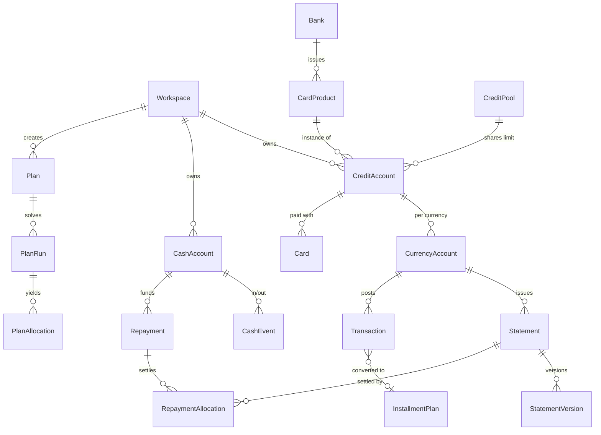
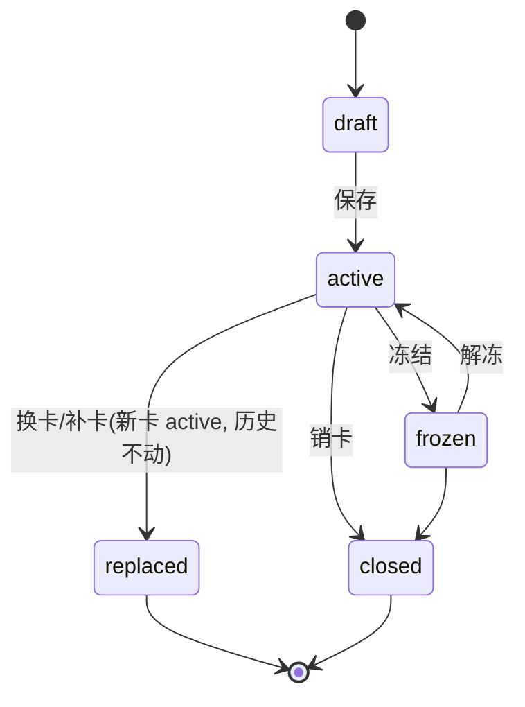
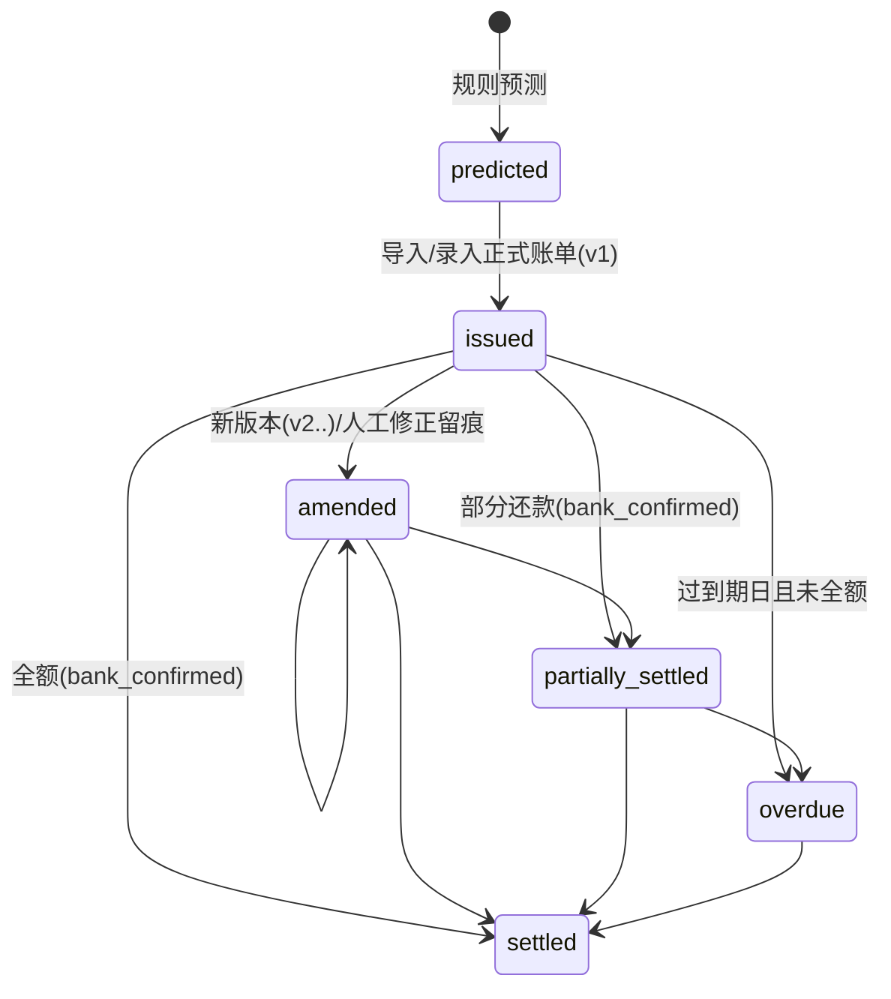
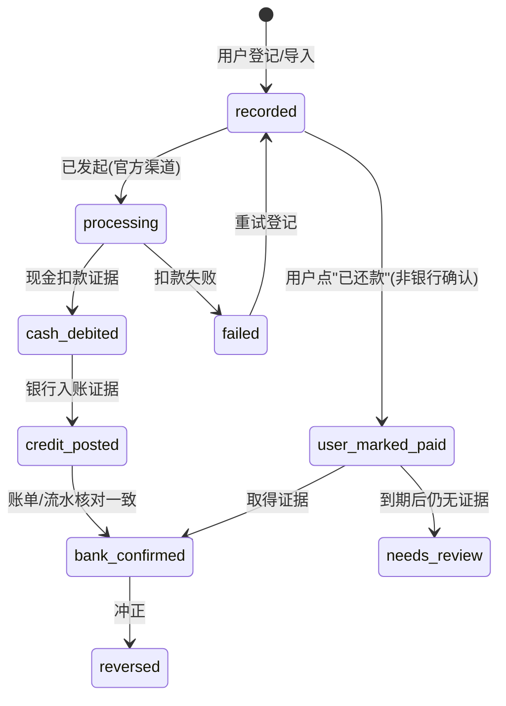

# 10 · PRD：卡序 CardFlow 产品需求文档（v1 完整范围）

版本 0.1 · 规划轮 2026-10-16 · 责任人：Fable 主会话 · 状态：待实施。需求编号 `R-<模块>-nn` 是追踪矩阵的主键；每条需求都带验收标准，"支持某功能"不是验收标准。

## 0. 术语表

| 术语 | 定义 |
|---|---|
| 卡片 Card | 物理或虚拟支付介质（末四位、卡组织、主/附、到期）。只是介质，不承载账单 |
| 信用账户 CreditAccount | 银行给持卡人的一个授信与账单主体；账单日、还款日、规则版本挂在这里 |
| 币种子账户 CurrencyAccount | 同一信用账户下按币种分设的子账户（如人民币/美元账户），各自账单与结算 |
| 授信池 CreditPool | 跨信用账户共享的额度上限（如"名下所有建行卡共享额度"），可多层 |
| 现金账户 CashAccount | 可用于还款的资金账户；有余额快照、可用性（理财/受限不默认当日可用）、储备底线 |
| 快照 Snapshot | 某时点观测到的余额/额度值，带来源、实际余额时点、记录时点、确认状态、已包含事件 |
| 事件 Event | 带时间语义的事实：event_time(UTC)+event_tz+精度、observed_at、recorded_at、来源、确认层级 |
| 确认层级 ConfirmationLevel | `system_estimated` 系统估计 / `user_confirmed` 用户确认 / `bank_confirmed` 银行确认 |
| 口径 Basis | `confirmed` 已确认 / `baseline` 基准预期 / `stress` 压力情景 |
| 账单版本 StatementVersion | 正式账单的每一次来源（PDF/邮件/截图/人工修正）都是一个版本，原值不被覆盖 |
| 计划 Plan / 求解运行 PlanRun | 用户的一次计划消费输入 / 对该输入的一次求解（run_id），历史不覆盖 |
| 预留 Reservation | 采纳计划后对卡片额度与现金的可撤销占用，真实交易录入后转换/核销 |
| 演示模式 Demo | 与真实数据隔离的独立数据集，界面持续标识 |

## 1. 产品定位

- **用户**：需要管理多张信用卡、已有账单和未来现金流的个人；先个人自用，可选自建 VPS 同步。
- **核心问题**："这笔已计划的消费，应该使用哪张卡、分别多少钱、何时出账、何时还款、届时哪个现金账户承担还款，以及有哪些确实适用的活动权益？"
- **价值主张**：可复现、可解释、可审计的记账与规划；不是"推荐卡片"的营销工具，也不是支付工具。
- **使用模式**：① 纯本地（默认，无账号）；② 自托管同步（用户部署后端，多设备）；③ 以上任一 + 可选邮件文件导入 + 可选 AI 辅助。

## 2. v1 范围与非目标

### 2.1 v1 必须包含的模块（全部属于完整 v1，没有"二期占位"）

| 模块 | 内容 | 需求段 |
|---|---|---|
| CARD | 首次使用、建卡、信用账户/币种子账户/授信池、额度模型、卡片生命周期 | §4.1 |
| STMT | 账单、交易、分期、还款（双侧时间）、退款/撤销/预授权、核对与差异 | §4.2 |
| CASH | 现金账户、快照、收支计划、三口径、情景、资金日历、缺口分析 | §4.3 |
| PLAN | 智能用卡输入、三类方案、解释、保存/采纳/预留/关联真实交易、过期 | §4.4 |
| PROMO | 活动发现→报名→进度→领取→到账核对→追回→到期 | §4.5 |
| BEN | 权益、积分、年费、卡片保留分析 | §4.6 |
| NOTIF | 提醒类型、本地/服务端/应用内三通道、去重撤销静默 | §4.7 |
| STAT | 统计指标与口径 | §4.8 |
| SYS | 搜索、主题、金额隐藏、锁屏、备份恢复、导出、设备、同步状态、删除、隐私、帮助、后台 | §4.9 |
| IMP | 手工/CSV/PDF/文本/截图/邮件文件导入、校对、去重、平台限制 | §4.10 |
| ARCH | 离线能力、同步与冲突、隐私架构、可关闭 AI | §8 与架构文档 |

### 2.2 明确非目标

发起支付/自动还款/借款申请/调额/改账单日；社交社区、商城、征信评分预测、贷款导流；虚构交易、商户伪装、规避风控；在没有银行 API/SDK/资质/授权证据时声称"实时同步银行"；iOS 读取短信收件箱；以 PWA 替代原生安装；任意抓取/转载活动网页；为凑活动门槛建议新增消费；v1 上架 App Store/Google Play 或经 TestFlight 分发（改为用户自签安装，ADR-015）。

## 3. 概念模型

**硬性语义**：
1. 同一信用账户的多张卡不能产生重复账单（账单挂币种子账户，不挂卡片）。
2. 同一银行的不同独立授信不能被合并（两个 CreditAccount，是否共享额度由 CreditPool 显式表达）。
3. 换卡/补卡/附属卡/销卡只改变 Card 的状态与关联，不移动/复制 Transaction、Statement、Repayment。
4. 每个事实有 event_time（UTC）+ event_tz + time_precision（`datetime`/`date`/`month`）、observed_at、recorded_at、source、confirmation_level。手机时区变化不得改变银行账期：账期计算只用账户业务时区。
5. 金额 = 整数最小单位 + 币种；不同币种最小单位不同（JPY 0 位、KWD 3 位）；汇总展示与原币结算分开；未知汇率不当 0。

## 4. 功能需求

格式：ID · 需求 · **验收标准**（可测试）。

### 4.1 CARD 首次使用、卡片与信用账户

- **R-CARD-01 建卡方式**：手工建卡、账单文件辅助建卡（从导入预览带出银行/末四位/账单日）、演示数据独立体验。**验收**：三种入口都能生成 CreditAccount + Card；演示数据只存在于演示工作空间。
- **R-CARD-02 卡片字段集**：银行、产品名、卡片别名、末四位、卡组织、持卡人、主/附卡关系、状态、到期（年月）提醒、规则来源。**验收**：不存在任何输入接受完整卡号、CVV、PIN、短信验证码或网银密码；末四位必须是 4 位数字；任何文本字段输入 ≥13 位连续数字时拒绝保存并提示。
- **R-CARD-03 四层区分**：卡片 / 信用账户 / 币种子账户 / 授信池。**验收**：F-21 同一信用账户两张卡导入同一账单→一份账单；F-22 同一银行两个独立授信→两个信用账户、两份账单；F-23 共享池内两账户可用额度合计不超过池上限。
- **R-CARD-04 卡片生命周期**：状态机见 §6.1；换卡、补卡、新增附属卡、销卡不破坏历史债务与账单关系。**验收**：F-24 换卡后旧卡交易仍归属同一币种子账户，账单/还款分配不变；销卡后账户若有未清余额仍显示。
- **R-CARD-05 额度模型**：固定额度、临时额度（含有效期）、专项/分期额度（用途、不可循环）、已用额度、可用额度、预授权占用、计划预留、额度变更历史。每个额度快照记录来源、实际余额时点、记录时点、确认状态、是否已含预授权。**验收**：F-25 银行可用额度已扣预授权时不重复扣减；F-26 原始负可用额度/超限原值保留，只有"可供新增消费的容量"按规则截为 0；F-27 临额到期后容量回落。
- **R-CARD-06 额度释放轨迹**：还款后额度何时实际释放按账户规则（银行确认入账后 + 释放时滞；未知→保守为"未释放"）。**验收**：F-28 还款到账前不释放额度，远期消费按消费当天的额度轨迹校验。

### 4.2 STMT 账单、交易、分期、还款与核对

- **R-STMT-01 账单要素**：本期已出账、未出账、本期剩余应还、最低还款额、历史逾期、利息、费用、年费、退款、撤销、预授权释放、分期计划、未来分期还款。**验收**：账单详情页逐项显示且每项有来源与版本。
- **R-STMT-02 负债四分法**：总负债、本期应还、未出账、未来分期本金分别显示，不重复相加。**验收**：F-30 一笔 12 期分期只在"未来分期本金"中计未到期本金，当期账单只计当期本金+费用；总负债 = 已出账未还 + 未出账 + 未来分期本金（不含未计提费用）。
- **R-STMT-03 还款状态机**：未还 / 部分还款 / 处理中 / 失败 / 用户标记已还 / 银行确认；"去还款"跳转与点击"已还款"不等于银行确认。**验收**：状态机 §6.3；没有 `bank_confirmed` 证据时到期提醒不自动消失，只降级为"待核对"。
- **R-STMT-04 还款双侧时间**：记录 payment_initiated_at、cash_debited_at、credit_posted_at 与证据；实际扣款、债务核销、额度释放分别判定。**验收**：F-31 扣款日与入账日不同的还款，在现金时间线按扣款日生效、在负债/额度按入账日生效。
- **R-STMT-05 冲突与分配**：自动扣款与手工还款冲突检测、部分冲抵、跨账单分配、重复导入核对。**验收**：F-32 同一天自动扣款 + 手工还款同额→生成"疑似重复还款"差异项而非双计；F-33 一笔还款分配到两期账单，分配和等于还款额。
- **R-STMT-06 退款处理**：退款是否冲抵当前应还、何时释放额度、是否追回权益，按账户规则；未知保持"待核对"；不默认作现金收入或必然抵扣本期应还。**验收**：F-34 退款在规则未知时进入待核对列表，账单应还不变，统计不计入收入。
- **R-STMT-07 账单版本与修正留痕**：正式账单保留每个来源版本；人工修正是新版本并记录操作者/时间/理由；银行原值不可覆盖。**验收**：数据库约束禁止 UPDATE statement_versions 的金额字段（只允许新增版本）。
- **R-STMT-08 消费统计口径**：消费按交易入账统计；信用卡还款、账户互转不再计入消费。**验收**：F-35 还款与互转的 transaction_type 在统计中排除。
- **R-STMT-09 对账差异与待处理**：差异清单（金额不符、缺失、重复、未匹配还款、退款待核对）；支持撤销错误导入、人工合并/拆分匹配；全部动作进审计。**验收**：每个差异项有类型、来源、建议动作、处理结果与处理者。
- **R-STMT-10 分期**：本金全额占额、逐期释放；每期本金/费用；尾差策略参数（默认末期）；提前结清；退货调整；成本按实际现金流 IRR 与"名义×12"分别展示。**验收**：F-36 分期拆分守恒；F-37 名义 1.5%×12=18% 与复利年化并列显示，不把月费率×12 标为"实际年化"。
- **R-STMT-11 溢缴款/贷方余额**：保留真实含义（负债为负），不用非负约束丢数据。**验收**：F-38 溢缴款账单显示"贷方余额"，本期应还为 0。

### 4.3 CASH 现金流与资金日历

- **R-CASH-01 现金账户**：余额快照（来源、时点、记录时点、确认状态、已包含事件）、可用性标记（理财/受限资金默认不可当日用于还款）、储备底线。**验收**：受限账户不进入求解硬约束的可用现金，除非用户设置可用日期。
- **R-CASH-02 收支计划**：确定/预计收入、固定生活支出、其他债务、一次性支出、周期事项。**验收**：周期事项生成的事件可逐条覆盖/跳过。
- **R-CASH-03 三口径**：已确认 / 基准预期 / 压力；"预计金额×概率"不得作为硬性偿债现金。**验收**：F-01 已确认口径下预计收入全部排除；没有"概率加权"字段进入硬约束。
- **R-CASH-04 情景**：收入延迟、收入减少、生活支出增加、额度变化；情景可保存、命名、重算、与历史版本对比。**验收**：F-02 收入延迟 3 天的情景使最低现金按期望变化。
- **R-CASH-05 逐账户检查**：不允许 A 账户余额自动支付 B 账户扣款；调拨以两端事件（转出/到账）及到账时间表示。**验收**：F-03 两账户隔离测试。
- **R-CASH-06 快照包含关系与同日顺序**：余额快照当天尚未发生/未包含的收支不能漏掉；优先时间戳；只有日期且顺序未知时用保守顺序（先支出后收入）并显式标记假设。**验收**：F-04（PoC 已验证）。
- **R-CASH-07 缺口输出**：全部缺口点（非仅首个）、全窗口最低点、距零/距储备两口径。**验收**：F-05（PoC 已验证）。
- **R-CASH-08 视图与覆盖**：7/30/90/180 天；预测区间至少覆盖新计划所有还款责任；超出仍有分期时显示尾部责任并可展开。**验收**：F-06 分期尾部责任在 180 天外仍列出。
- **R-CASH-09 数据不足降级**：余额过期（默认 >7 天）、缺快照、待还覆盖不完整→指出具体缺什么，标记"假设分析"，不补零。**验收**：F-07（PoC NEEDS_DATA 已验证）。
- **R-CASH-10 先验基线**：新增消费前先检查基线缺口；有缺口→ BASELINE_SHORTFALL。**验收**：F-08（PoC 已验证）。
- **R-CASH-11 消费贷（2026-10-19 用户新增）**：登记贷款（贷款机构、产品名、本金、年化利率、放款日、到期日、每月还款日、扣款现金账户），还款方式 v1 只做"按月付息、到期还本"；计息方式可选"按月固定（本金 × 年化 ÷ 12）""按日计息（年 360 天）""按日计息（年 365 天）"，金额用有理数计算、四舍五入到分；生成还款计划（最后一期还本付息），每期金额可按贷款机构账单更正；每期可"标记已还"；未还的各期作为计划中的其他债务进入资金日历（窗口外的进入尾部责任）。只记录与提醒，不做借款申请、贷款导流或比价（§2 非目标不变）。**验收**：本金 100,000、年化 3.6%、按月固定 → 每期利息 300.00，最后一期 100,300.00；按日计息跨 2 月与闰年的天数正确；改本期金额只影响该期；资金日历按扣款账户逐日扣减；首页"卡账"列出下次还款日与金额、到期还本日。

### 4.4 PLAN 智能用卡与计划管理

- **R-PLAN-01 输入**：金额、日期、币种、商户/品类、支付渠道、能否拆单、最多卡数、单笔最小金额、支付费用、是否允许分期、要预留的现金与卡片额度。**验收**：字段校验规则见 UI 规格 P-10。
- **R-PLAN-02 拆单默认关闭**：只有用户确认商户支持才计算多卡组合（K>1）。**验收**：F-09 K=1 时样本不可行并给出原因（PoC 已验证）。
- **R-PLAN-03 金额口径**：计划金额为本次需支付净额；原价、即时优惠、卡片扣款、后续返现分别定义，不重复计算同一优惠。**验收**：输入页显示四项并自动校验 净额 = 原价 − 即时优惠。
- **R-PLAN-04 三类可比较方案**：现金安全优先 / 已核实净收益优先 / 少用卡优先；全部先满足同一组硬约束。**验收**：三画像均通过独立验证器（PoC 已验证）。
- **R-PLAN-05 方案输出**：每方案列出卡片、金额、预计记账区间、账单归属、到期日或范围、计划扣款时间、付款缓冲天数、最低现金及日期、压力情景结果、费用、确定收益、潜在收益、关键假设；并展示未选其他卡的原因。**验收**：输出契约见引擎规格 §7；拒绝原因枚举完整。
- **R-PLAN-06 保存/采纳/预留**：保存模拟不改变真实余额与账单；采纳→可撤销预留（额度与现金）；真实交易录入后预留转换/核销；不得同时保留计划与实际交易造成双扣。**验收**：F-10 采纳后再录入真实交易，额度占用与现金预期只计一次。
- **R-PLAN-07 过期**：输入或规则变化后旧方案标记过期并提示重算。**验收**：快照/事件/规则版本任一变化触发 stale。
- **R-PLAN-08 状态展示**：求解器状态 + 业务状态（NEEDS_DATA、BASELINE_SHORTFALL、CONDITIONALLY_FEASIBLE、FEASIBLE_ROBUST、INFEASIBLE、UNKNOWN、MODEL_INVALID）；不一律绿色通过。**验收**：UI 状态映射表（UI 规格 §5）。
- **R-PLAN-09 无解解释与敏感性**：首次缺口日期、账户、现金缺口、距储备缺口；减少消费/调整日期/补充已确认资金后的结果；不假设新增借款、提额或以卡养卡。**验收**：F-11（PoC 已验证：最少补充 4,000、最大可负担 6,000、推迟 5 天）。

### 4.5 PROMO 活动中心

- **R-PROMO-01 闭环**：发现、收藏、报名状态、资格核验、消费进度、待领取奖励、到账核对、退款追回、到期提醒。**验收**：状态机 §6.6 每个状态有页面入口。
- **R-PROMO-02 来源策略**：官方银行/卡组织页面、公告或获许可数据源优先；用户分享网页、粘贴条款、导入截图；来源白名单、抓取频率、内容使用权限、版本差异、复核流程、失效下架；取不到内容时保存链接请用户补充。**验收**：后台来源配置含 robots/许可字段；未许可来源禁止自动抓取。
- **R-PROMO-03 活动字段集**：适用银行与卡产品、主体范围（持卡人/账户/卡片）、报名时间、消费统计时间、记账时间要求、活动时区、指定商户或 MCC、渠道与地区、单笔/累计门槛、全额返还/仅超额部分、奖励比例、封顶、次数、共享上限、叠加/互斥、奖池与排序方式、奖励入账周期、退款/撤销影响、有效版本、来源与核验时间。**验收**：以 S07 活动为样本能无损表达（F-40）。
- **R-PROMO-04 三态资格**：符合/不符合/未知；MCC、名额余量、用户定向资格未知→"待确认"，不从店名或通用网页推断为确定。**验收**：资格判断输出 `unknown_reasons[]`。
- **R-PROMO-05 声明式规则**：受 schema 校验的规则模型，不对抓取内容执行代码；取整、统计周期、退款追回有测试。**验收**：F-41 取整（截断两位）、F-42 月奖池不结转、F-43 退款追回。
- **R-PROMO-06 三层状态**：系统估计已达标 / 用户确认报名或领取 / 银行确认到账；未到账不进入确定现金。**验收**：现金流中奖励只以 expected 事件出现，直到 bank_confirmed。
- **R-PROMO-07 不诱导消费**：不为凑门槛建议新增原计划之外的消费。**验收**：引擎不生成"再消费 X 元可达标"类建议；只在用户已有计划上评估。

### 4.6 BEN 权益、积分与年费

- **R-BEN-01 权益定义**：类型（接送机、贵宾厅、酒店、餐饮、体检、保险等）、资格、额度单位（次/金额）、周期（年度/自然年/持卡年/滚动）、共享范围、预约要求、使用/取消记录、到期与续期；不预置每张卡都有。**验收**：新建信用账户默认无权益；权益来自用户录入或已核验产品模板。
- **R-BEN-02 权益状态机**：可用、已预约、已使用、取消待恢复、已恢复、已失效；取消不自动返还次数。**验收**：§6.7；取消后进入"取消待恢复"，需用户/银行确认恢复。
- **R-BEN-03 保险权益**：只整理条款与索赔入口，不保证赔付。**验收**：保险类不计入"已实现权益价值"。
- **R-BEN-04 积分**：按账户、来源批次、有效期；累计/兑换/失效/退回记录；估值由用户或可核实兑换选项提供，不按宣传价计现金。**验收**：F-44 批次到期先进先出扣减；无估值时价值显示"未估值"。
- **R-BEN-05 年费**：收费日期、减免所需消费次数/金额、积分抵扣、已达标待确认、实际收费/返还、下个周期。**验收**：F-45 达标判定分"系统估计"与"银行确认"。
- **R-BEN-06 卡片保留分析**：已实现权益价值、主观估值、年费、其他成本分开展示，不合成单一分数。**验收**：页面 P-17 四列分列。

### 4.7 NOTIF 提醒与通知

- **R-NOTIF-01 类型**：账单生成、还款准备、到期、扣款失败、临额到期、报名/领取截止、权益与积分过期、年费达标；提前天数可设置；不把宽限期当常规目标。**验收**：默认提前天数：还款准备 3 天、到期当天、截止 2 天；宽限期字段只用于"逾期判定说明"。
- **R-NOTIF-02 三通道**：本地通知、可选服务端通知、应用内消息中心；去重键、更新、撤销、重试、静默时间。**验收**：F-46 同一账单修改到期日后旧通知被撤销并重排；静默时段内不弹出但消息中心可见。
- **R-NOTIF-03 不承诺必达**：显示通知权限与调度状态；提供应用内待办作为替代。**验收**：权限被拒时首页显示待办条。
- **R-NOTIF-04 锁屏隐私**：锁屏通知默认隐藏金额。**验收**：通知正文模板不含金额，除非用户显式开启。

### 4.8 STAT 统计

- **R-STAT-01 指标**：实际消费、现金收支、负债、本期应还、未来压力、费用/利息、已实现返现、已使用权益；每项给口径；预测与实际分列。**验收**：§7 口径表每项有计算定义与测试。

### 4.9 SYS 系统管理与后台

- **R-SYS-01** 搜索筛选（卡、交易、账单、活动、权益）；**R-SYS-02** 深浅主题；**R-SYS-03** 金额隐藏（全局开关 + 长按临时显示）；**R-SYS-04** 锁屏保护（系统生物识别/设备密码，自定义超时）；**R-SYS-05** 加密备份与恢复（含完整性校验）；**R-SYS-06** 导出（CSV/JSON，加密 zip 可选）；**R-SYS-07** 设备管理（自托管模式）；**R-SYS-08** 同步状态（最后同步时间、待推送数、冲突数）；**R-SYS-09** 数据删除（本地抹除、服务端删除任务与宽限期）；**R-SYS-10** 隐私授权中心（每项数据外送的开关与说明）；**R-SYS-11** 帮助与口径说明。
- **R-SYS-12 后台**：银行规则版本、活动版本、导入模板、失败任务、审计、备份；运营角色默认不可查看用户账单正文（只看元数据/统计）。**验收**：RBAC 测试：operator 角色访问账单正文接口返回 403 且审计记录。
- **R-SYS-13 演示模式**：明显标识，与真实数据隔离（独立工作空间、不可合并、不同步）。**验收**：演示数据不出现在真实工作空间任何查询。

### 4.10 IMP 数据进入方式

- **R-IMP-01 渠道**：手工录入、CSV 导入、PDF/账单文本导入、截图辅助录入、.eml/HTML 导入、用户主动分享文件；导入结果预览与逐字段校对。**验收**：每个渠道有端到端测试样本。
- **R-IMP-02 解析顺序**：优先文本层与结构化字段；仅无文本的扫描件/图片用 OCR；加密 PDF 由用户提供密码，不推测，不长期保存。**验收**：密码只存内存，解析完成即清除；日志不含密码。
- **R-IMP-03 隔离与恢复**：大文件（默认 ≤25 MB）、压缩包（不递归解压）、恶意文件（类型嗅探、禁用 JS/外链）、重复文件、超时（默认 120 s）均隔离并可重试。**验收**：F-47 恶意样本集。
- **R-IMP-04 字段溯源**：原始位置（页/坐标/行）、抽取值、解析器版本、置信度/校验结果、人工确认；置信度=规则校验 + 交叉校验，不只用模型自报。**验收**：每个入账字段可回溯到 ExtractionCandidate。
- **R-IMP-05 校验**：金额关系（明细和=合计、应还=上期+本期−还款±调整）、周期、币种、末四位映射；关键冲突未确认不得入正式台账。**验收**：F-48 合计不符时批次停在 needs_review。
- **R-IMP-06 幂等与去重**：文档指纹 + 银行参考号 + 信用账户 + 交易类型 + 币种 + 入账时间 + 关联证据；区分同日同额多笔、预授权转入账、部分退款、多来源重复；同一账单的 PDF/邮件/截图不生成三笔负债。**验收**：F-49 同一导入重复执行余额不变；F-50 同日同额两笔真实交易保留两笔。
- **R-IMP-07 平台限制**：iOS 不读取短信收件箱；IdentityLookup 不作为账单同步接口；Android 短信为受权限与分发政策约束的可选适配器，不作为使用前提，不用其他敏感权限绕过。**验收**：iOS 工程无短信相关权限；Android 短信模块可独立编译排除。
- **R-IMP-08 邮件**：选定文件/分享/.eml/HTML/PDF；经明确授权的指定邮件导入；"自动转发"若需收信服务，列出真实域名、邮箱服务与隐私依赖；Gmail OAuth 另列受限 scope 审核与安全评估条件；拒绝连接不影响其他功能；标签过滤≠scope 限制。**验收**：隐私授权中心逐项显示。
- **R-IMP-09 覆盖矩阵**：§9；界面不得声称"已实时同步全部银行"。

## 5. 用户流程（端到端）

每个流程：触发 → 步骤 → 异常分支 → 结束状态 → 页面。

**UF-1 首次打开 → 本地模式 → 添加信用账户/卡片 → 设置账期与余额**
1. 欢迎页说明本地模式、无需注册；可选"体验演示数据"（进入演示工作空间）。
2. 选择"手工建卡"或"从账单文件开始"。
3. 填写银行/产品/别名/末四位/卡组织/持卡人；系统创建 CreditAccount（默认 CNY 子账户）与 Card。
4. 设置账单日与到期规则（固定日/账单后 N 天）、业务时区（默认 Asia/Shanghai）、额度快照（固定/临时/可用、时点）。
5. 添加现金账户与余额快照、储备底线。
6. 结束：总览显示该账户"预测账期（未出账）"。异常：末四位重复→提示可能是同一账户的另一张卡；账期规则非法（到期早于账单日）→阻止保存。页面 P-01、P-02、P-03、P-04、P-08。

**UF-2 导入账单 → 识别 → 逐字段校对 → 去重 → 入账 → 差异处理**
1. 选择文件/分享进入；创建 ImportBatch + SourceDocument（指纹）。
2. 解析任务（本地或服务端）→ ExtractionCandidate 列表 + 置信度 + 原始位置。
3. 校对页逐字段确认；映射到信用账户（末四位）；冲突字段必须人工选择。
4. 去重：与既有账单版本、交易按 R-IMP-06 规则比对；展示"疑似重复/新版本/新交易"。
5. 确认入账：生成 StatementVersion 与 Transaction；生成差异项（若合计不符）。
6. 结束：账单中心显示新版本；差异清单待处理。异常：加密 PDF 要密码；解析超时可重试；用户撤销批次→回滚（tombstone）。页面 P-05、P-06、P-13。

**UF-3 登记还款 → 现金扣款 → 银行确认 → 负债与额度核对**
1. 在账单页"登记还款"：金额、现金账户、发起时间、方式。
2. 状态 `recorded`；现金时间线按预计扣款日生成 PLANNED/EXPECTED 事件。
3. 用户确认扣款（或导入流水匹配）→ `cash_debited`，记录 cash_debited_at。
4. 银行入账证据（账单/App 截图/下期账单）→ `credit_posted` → `bank_confirmed`。
5. 额度释放按规则生成；差异（金额不符、重复）进入待处理。
6. 结束：账单 settled/partially_settled。异常：失败→`failed`，提醒重排；自动扣款与手工重复→差异项。页面 P-05、P-06、P-13。

**UF-4 计划消费 → 输入校验 → 比较组合 → 解释 → 保存/采纳 → 真实交易关联**
1. 输入金额/日期/币种/商户/渠道/拆单/K/最小金额/费用/分期/预留。
2. 数据检查：缺快照/过期→NEEDS_DATA 提示补数据；可"按假设继续"。
3. 求解（本地可行性 + 服务端 CP-SAT）→ 三类方案 + 状态。
4. 方案详情：逐卡账期/扣款/缓冲/最低现金/情景；未选卡原因；敏感性。
5. 保存（不影响真实数据）或采纳（创建 Reservation）。
6. 真实交易录入/导入→匹配预留→转换/核销。
7. 结束：计划 linked。异常：INFEASIBLE→解释页；UNKNOWN→"超时，可延长或减少约束"；规则/快照变化→stale。页面 P-10、P-11、P-12。

**UF-5 资金日历 → 缺口 → 调整假设 → 重新计算 → 历史版本对比**
1. 日历视图（7/30/90/180 天）按账户/口径切换。
2. 缺口点高亮，显示距零/距储备。
3. 调整假设（收入延迟/减少、支出增加、额度变化）保存为情景。
4. 重算并与上一个版本对比（差异表）。
页面 P-07、P-09。

**UF-6 活动导入 → 资格确认 → 报名 → 消费进度 → 领取 → 到账核对**
1. 从后台库/分享链接/粘贴条款/截图创建 Promotion（版本 + 来源 + 核验时间）。
2. 资格三态判断；未知项列待确认。
3. 用户在官方渠道报名后回 App 标记"已报名"（user_confirmed）。
4. 交易入账后系统估计进度与奖励（system_estimated）。
5. 用户确认领取；导入流水/账单匹配到账→bank_confirmed。
6. 退款→追回计算；到期提醒。页面 P-14、P-15。

**UF-7 权益预约 → 使用/取消 → 次数核对；积分到期与年费达标查看**
页面 P-16、P-17、P-18。

**UF-8 离线编辑 → 恢复联网 → 同步冲突 → 人工解决**
1. 离线：本地写入 + outbox。2. 联网：推送（幂等键、版本号）。3. 冲突：服务端返回冲突记录（不自动覆盖金额）。4. 冲突界面：并排显示两版本、来源、时间；用户选择或合并；两台设备同时登记同一还款→"疑似重复还款"差异。页面 P-21。

**UF-9 导出/加密备份 → 新设备恢复 → 完整性核验；撤回授权/删除数据**
1. 备份：选择范围（含附件否）、设置口令（派生密钥）、生成文件 + 校验摘要。2. 新设备恢复：校验摘要与版本；冲突策略。3. 撤回授权：隐私中心逐项关闭。4. 删除：本地抹除（含 Keychain 条目）、服务端删除任务（宽限期、审计保留策略一致）。页面 P-19、P-20。

## 6. 状态机

### 6.1 卡片 Card

### 6.2 账单 Statement

**2026-10-19 主会话裁决（I-1 阶段末审查 R-02/R-03/R-06，Q-4/Q-5）**：上图是**存储状态**（动作记录，触发器照此约束）。界面、近期到期、逾期提醒与首页一律用读模型推导的**有效状态**，由金额与日期决定，不另加存储状态：
- **接续**：同一币种子账户里最近一期账单是"本期"；更早的账单视为"已并入下一期"（下一期的新增账单已含其未还部分），不计入负债与应还、不进近期到期、不标逾期、不再接受分配。
- **本期剩余应还** = 本期当前版本的新增账单 − 入账日**晚于**本期账单日的银行已入账还款（不论分配到哪一期）± 已出账消费转分期的调整（本期版本录入早于分期计划时：− 分期本金 + 账单日等于本期的首期本金与手续费）。入账日不晚于账单日的还款已反映在新增账单里，不再扣减。
- **有效状态**：剩余应还 > 0 → 未到期为"待还/已还一部分"，过了到期日为"已逾期"；≤ 0 → 有银行确认为"已还清"，只有入账未确认为"已入账（待银行确认）"，因转分期而为 0 时为"已转分期"；< 0 为贷方余额。冲正、人工修正后自动重新推导。

### 6.3 还款 Repayment

### 6.4 导入批次 ImportBatch
`uploaded → parsing → needs_review → confirmed → posted`；分支 `failed`（可重试）、`rolled_back`（撤销，产生 tombstone 与审计）。
### 6.5 计划 Plan / 求解运行 PlanRun
`draft → solving(run_id) → solved{OPTIMAL|FEASIBLE} | infeasible | unknown | needs_data | baseline_shortfall | model_invalid`；`solved → adopted(reservation) → linked(actual txn)`；任一输入变化 `→ stale`；`cancelled` 释放预留。
### 6.6 活动 Promotion（用户视角）
`discovered → saved → enrolled(user_confirmed) → in_progress(system_estimated) → reward_estimated → reward_claimed(user_confirmed) → reward_posted(bank_confirmed)`；分支 `ineligible`、`unknown_eligibility`、`expired`、`clawed_back`。
### 6.7 权益授予 BenefitGrant
`available → reserved → used`；`reserved → cancel_pending_restore → restored | forfeited`；`available → expired`。
### 6.8 积分批次 PointsBatch
`accrued → partially_redeemed → redeemed`；`accrued → expired`；`accrued → reversed`（退款追回）。
### 6.9 年费周期 AnnualFeeCycle
`pending → waiver_in_progress → waiver_met_estimated → waiver_confirmed`；`pending → charged → refunded | paid`。
### 6.10 通知 Notification
`scheduled → delivered | suppressed(静默) | cancelled | failed → retry(≤3) → dead`；`scheduled → updated`（同去重键）。
### 6.11 同步记录 SyncOutbox
`local_dirty → queued → pushed → acked`；`pushed → conflict → resolved(user)`；`acked → tombstoned`（删除）。

## 7. 指标口径

| 指标 | 定义 | 包含/排除 | 口径 |
|---|---|---|---|
| 实际消费 | 期间内 `transaction_type ∈ {purchase, installment_purchase, fee?否}` 且已入账的交易金额和（原币与折算分列） | 排除还款、互转、预授权未入账、退款（作负项单列） | 实际 |
| 现金收支 | 现金账户已确认流入/流出事件和 | 排除预计事件 | 实际/已确认 |
| 负债 | 已出账未还 + 未出账 + 未来分期本金 | 不含未计提费用；溢缴款为负 | 实际 |
| 本期应还 | 各币种子账户当前账单剩余应还 | 已核销部分扣除（bank_confirmed） | 实际 |
| 未来压力 | 各情景下未来 N 天最低现金与缺口 | 按口径分列 | 预测 |
| 费用/利息 | 已入账费用与利息 | 预估费用单列 | 实际/预测 |
| 已实现返现 | bank_confirmed 奖励 | 估计奖励单列 | 实际 |
| 已使用权益 | used 状态权益次数/价值 | 取消待恢复不计 | 实际 |

## 8. 无后端/离线能力矩阵

| 能力 | 纯本地 | 自托管联网 | 离线（已登录） |
|---|---|---|---|
| 卡片/账户/额度/账单/交易/还款录入与查看 | 可用 | 可用 | 可用（本地权威，稍后同步） |
| CSV/PDF 文本层导入 | 可用（本地解析） | 可用 | 可用 |
| OCR 截图辅助 | 可用（设备端 OCR） | 可用（可选服务端） | 可用（设备端） |
| 现金流/资金日历/情景 | 可用 | 可用 | 可用（标明数据时点） |
| 智能用卡 | 可行性验证 + 有限搜索（标注不完整性） | CP-SAT 完整求解 | 同纯本地 |
| 活动库更新 | 手工导入 | 自动更新 | 使用缓存 |
| 邮件文件导入 | 可用 | 可用 | 可用 |
| Gmail OAuth 自动导入 | 不可用 | 可选 | 排队 |
| 提醒 | 本地通知 | 本地 + 服务端 | 本地 |
| 备份恢复 | 本地加密文件 | 本地 + 服务端 | 本地 |
| 后台 | 不可用 | 可用 | 不可用 |
| AI 辅助 | 不可用（除设备端模型，v1 不含） | 可选 | 不可用 |

## 9. 数据来源覆盖矩阵

| 渠道 | 能读什么 | 不能读什么 | 更新时点 | 平台/政策约束 |
|---|---|---|---|---|
| 手工录入 | 一切字段 | — | 即时 | — |
| CSV | 银行导出的交易/账单明细 | 未导出的字段（如预授权） | 用户导入时 | — |
| PDF 账单（文本层） | 账单要素、明细、分期 | 实时未出账交易 | 账单日后 | 加密 PDF 需密码 |
| 扫描件/截图 OCR | 可见文本（置信度较低） | 被遮挡/截断内容 | 用户导入时 | 中文 OCR 模型需核验 |
| .eml/HTML 邮件文件 | 邮件正文/附件账单 | 非账单邮件 | 用户导入时 | — |
| 指定邮箱授权导入（可选） | 用户授权范围内的账单邮件 | 其他邮件 | 周期拉取 | Gmail 受限 scope 审核；IMAP 需应用专用密码 |
| Android 短信（可选适配器） | 交易/账单提醒短信 | 非短信通知 | 实时 | 仅上架 Play 时需 SMS 政策声明表与审核（v1 不上架，ADR-015）；不作为前提 |
| iOS 短信 | **不可读** | 全部 | — | IdentityLookup 仅垃圾过滤 |
| 银行 API | **本项目无** | 全部 | — | 无资质/授权证据 |

## 10. 演示模式

独立 `demo` 工作空间；全局横幅"演示数据"；禁止同步、导出到真实空间、合并；一键清除；演示规则与活动样本标注"仅示例"。

## 11. 平台与发布形态

iOS 为主要体验目标（交付路径：Mac 构建 → 用户自签安装到真机），Android 完整功能（release APK，用户自签），v1 不上架、不走 TestFlight（ADR-015）；Web 后台（桌面优先、响应式）；PWA 仅作后台或只读补充。版本策略：移动端与后端 API 版本兼容矩阵由 API 契约维护。

## 12. 跨领域需求登记（非功能与工程需求）

以下需求与功能需求同属 v1 验收范围，详细规格在对应文档；此处登记 ID 以供追踪矩阵引用。

| ID | 需求 | 规格位置 |
|---|---|---|
| R-RULE-01 | 交易日、记账日、账单日、到期日、建议还款日、现金扣款日、银行确认日七分法 | bank-rules-spec §1 |
| R-RULE-02 | 规则对象模型：主体、来源、公布/生效/失效/核验日、版本、审核状态、例外；已出账单优先 | bank-rules-spec §2 |
| R-RULE-03 | 账单归属：账单日当天归属开关、月末截断、闰年 | bank-rules-spec §3 |
| R-RULE-04 | 到期规则：固定日（当月/次月）、账单后 N 自然日/工作日；非法规则即 MODEL_INVALID | bank-rules-spec §3 |
| R-RULE-05 | 规则版本按入账日选择；变更不改写已出账单 | bank-rules-spec §3 |
| R-RULE-06 | 入账窗口不确定输出多账期并按最早到期保守校验；顺延仅在已核验日历下 | bank-rules-spec §3 |
| R-RULE-07 | 免息资格按账户与交易类型；未知不按零成本；分期成本 IRR 与名义分列 | bank-rules-spec §4 |
| R-RULE-08 | 额度语义：固定/临时/专项/已用/可用（可负）/预授权/预留/容量截零/共享池多层/释放轨迹 | bank-rules-spec §5 |
| R-RULE-09 | 退款、撤销、预授权转入账的三态处理 | bank-rules-spec §6 |
| R-ENG-01 | 引擎输入契约（rules-protocol v1） | engine-spec §2 |
| R-ENG-02 | 整数分 CP-SAT 模型与逐检查点现金约束 | engine-spec §3 |
| R-ENG-03 | 三画像分层目标 | engine-spec §4 |
| R-ENG-04 | 求解器状态直传；超时为 UNKNOWN 非无解 | engine-spec §7 |
| R-ENG-05 | 情景分离与业务状态（NEEDS_DATA/BASELINE_SHORTFALL/CONDITIONALLY_FEASIBLE/FEASIBLE_ROBUST…） | engine-spec §5 |
| R-ENG-06 | 输出契约：分配、验证、拒绝原因、敏感性、运行记录 | engine-spec §6 |
| R-ENG-07 | 每次运行独立 run_id，历史不覆盖 | engine-spec §11 |
| R-ENG-08 | 本地离线求解边界与双端 golden fixtures 一致 | engine-spec §8 |
| R-DATA-01 | 金额整数最小单位 + 币种；无 float | data-model 约定 |
| R-DATA-02 | 事件/观测/记录三时间 + 时区 + 精度 | data-model 约定 |
| R-DATA-03 | 财务事实追加更正、版本化、触发器禁止覆盖 | data-model §4 |
| R-DATA-04 | 幂等键唯一并与事务提交关联 | data-model §4 |
| R-DATA-05 | 工作空间所有权：复合外键 + RLS + 绕过测试 | data-model §6 |
| R-DATA-06 | 迁移策略 expand/contract 与往返测试 | data-model §7 |
| R-API-01 | API 通用约定：鉴权、幂等、版本并发、分页、错误、异步、速率 | api-contract §1 |
| R-ARCH-01 | 无后端/离线能力矩阵 | PRD §8 |
| R-ARCH-02 | 同步：outbox、游标、行版本、幂等重放、tombstone、冲突外显、重复还款核对 | architecture §6 |
| R-ARCH-03 | 隐私架构明确为服务器可解密自托管同步并如实告知 | ADR-006 |
| R-ARCH-04 | AI 为可关闭辅助且不写入正式数据 | ADR-013 |
| R-ARCH-05 | 模块化单体 + PG 队列 + 隔离部署 | ADR-002/003 |
| R-UI-01 | 五主导航固定与双入口（账单/活动/权益/积分/年费从总览、卡片详情、发现均可达） | ui-spec §1 |
| R-UI-02 | 每页九种状态（首次空白/加载/无权限/离线/余额陈旧/数据不全/错误/重试/成功） | ui-spec §2、§6 |
| R-UI-03 | 风险与状态 = 图标+文字+颜色；引擎状态映射，绿色与“稳妥”仅 FEASIBLE_ROBUST | ui-spec §5 |
| R-UI-04 | 外链仅走已核验官方链接；返回只询问/核对，不自动标记成功 | ui-spec §4.1 |
| R-UI-05 | 可访问性（对比度 ≥4.5:1、触控 ≥44pt、大字号、屏幕阅读器、减少动效）与数字金额呈现（等宽对齐、最小单位、负数语义词、汇率未知不折算） | ui-spec §3.4、§3.5 |
| R-UI-06 | （编号退役：已合并入 R-UI-04，不再复用） | — |
| R-UI-07 | 确认层级（系统估计/用户确认/银行确认）在界面可见且不混用 | ui-spec §4.3 |
| R-UI-08 | 金额隐藏、锁屏、任务切换遮罩、通知不含金额 | ui-spec §3.6 |
| R-SEC-01 | MASVS 八组控制清单 | security-privacy §3 |
| R-SEC-02 | 服务端控制（最小权限、TLS、会话、秘密、日志、审计、备份） | security-privacy §4 |
| R-SEC-03 | 密钥层级、轮换与丢失后果 | security-privacy §5 |
| R-SEC-04 | 非可信输入处理（文件、HTML、URL、提示注入） | security-privacy §9 |
| R-SEC-05 | 合规与发布待核查清单 | security-privacy §10 |
| R-TEST-01 | 覆盖矩阵与 golden fixtures | test-plan |
| R-TEST-02 | 性质测试 | test-plan §3 |
| R-TEST-03 | 性能目标、规模、方法与"目标值"标注 | test-plan §8 |
| R-DEL-01 | Fable/Opus 分工与交叉审查 | milestones §3/§4 |
| R-DEL-02 | 完成定义 | milestones §5 |
| R-DEL-03 | Android 自签构建与安装验证（ADR-015） | WP-50 |
| R-DEL-04 | iOS 构建与用户自签安装交付路径（ADR-015） | WP-51 |
| R-DEL-05 | 自托管部署、健康检查与恢复证据 | WP-52 |
