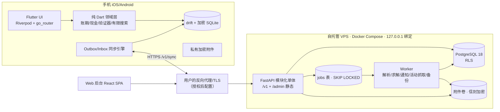
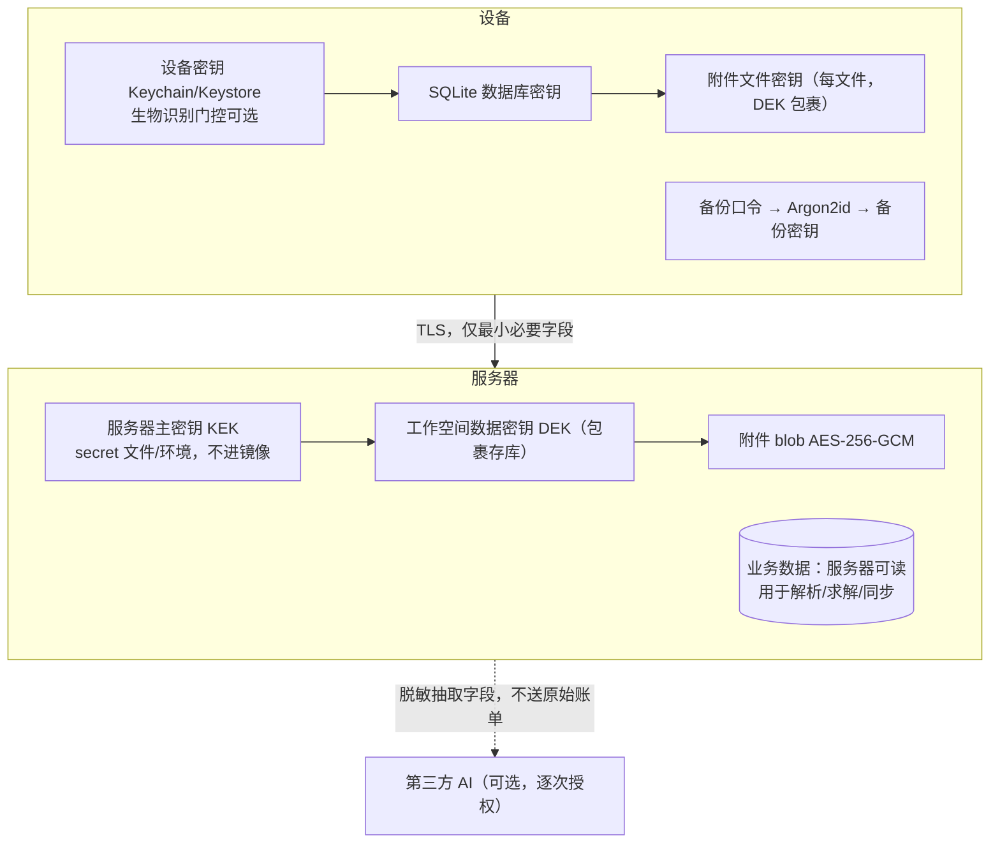

# 20 · 架构文档

版本 0.1 · 2026-10-16。决策记录见 `adr/`。版本号来自 `sources.md` S17–S26 的实时核验。

## 1. 目标与约束

| 目标 | 体现 |
|---|---|
| 可安装、保存真实数据、长期运行 | 原生 Flutter App + 本地加密 SQLite 为默认权威；无后端也完整可用 |
| 资金正确性最高优先 | 整数最小单位、显式取整、追加更正、独立验证器、golden fixtures 双端一致 |
| 本地优先，联网可选 | Repository 单一数据源（S09）；outbox/游标同步；冲突不静默覆盖 |
| 隐私最小化 | 默认不外送；AI 可关闭且只送最小必要脱敏字段；附件加密 |
| 运维简单 | 模块化单体 + 一个 worker + PostgreSQL；Docker Compose；不引入 Redis/K8s |
| 与宿主隔离 | 独立 Compose 项目、独立数据库容器、仅 127.0.0.1 端口 |

约束：本环境无 macOS/Xcode（iOS 构建外部化）；无银行 API；个人自用起步但数据模型按多用户隔离设计；移动端由用户自签分发，v1 不上架（ADR-015）。

## 2. 总体拓扑



## 3. 移动端架构

分层（依赖只向下）：
1. **Presentation**：页面 widgets、Riverpod providers/notifiers、go_router 路由（五个主导航）。
2. **Application**：用例（建卡、导入批次、登记还款、求解、采纳、同步、备份）。
3. **Domain（纯 Dart，无 Flutter 依赖）**：实体与值对象（`Money{minor,currency}`、`EventTime{utc,tz,precision}`）、规则引擎 Dart 移植（`billing`、`cash_timeline`、`verifier`、`bounded_search`）、状态机。
4. **Data**：drift 数据库（加密）、仓库、同步引擎（outbox/inbox/冲突）、API 客户端（dio）、解析器（CSV、PDF 文本层、ML Kit 中文 OCR）、文件接入（file_picker、receive_sharing_intent）、通知调度（flutter_local_notifications）、安全存储（flutter_secure_storage）、生物识别（local_auth）、后台任务（workmanager，尽力而为）。

功能模块：onboarding、cards、statements、cash、planner、promotions、benefits、notifications、imports、settings（backup/sync/privacy/delete）、demo。每个模块有自己的仓库接口与测试。

本地求解边界：Domain 层只提供验证器与有限搜索；CP-SAT 在服务端。两端用同一 JSON 协议（§10）。

## 4. 后端模块化单体

Python 3.13 · FastAPI 0.143 · SQLAlchemy 2.1 · Alembic 1.20 · psycopg 3.3 · OR-Tools 9.15。

```
cardflow/
  api/            # 路由层，仅做鉴权/校验/编排
  identity/       # 设备注册、可选账号、令牌、会话撤销
  workspaces/     # 工作空间、成员、角色、同意记录
  cards/          # 银行、产品、信用账户、币种子账户、卡片、额度、授信池
  statements/     # 交易、账单版本、分期、还款、分配、对账差异
  cash/           # 现金账户、快照、事件、情景、预测运行
  planner/
    engine/       # 纯 Python：模型、求解、验证器（无框架依赖；与 PoC 同源）
    service/      # 运行记录、预留、失效
  promotions/     # 活动、规则版本、来源、报名、进度、奖励台账
  benefits/       # 权益、积分、年费
  notifications/  # 规则、投递、去重
  imports/        # 文档、解析任务、候选、批次、去重
  sync/           # push/pull、变更日志、冲突
  admin/          # 后台接口（RBAC）
  audit/          # 审计写入
  jobs/           # PostgreSQL 任务表与 worker 循环
  crypto/         # 信封加密、密钥轮换
  ai/             # 可选适配器（可整体禁用）
```

Worker：同一代码库 `cardflow worker` 进程，轮询 `jobs`（`FOR UPDATE SKIP LOCKED`），按任务类型限制并发与超时（解析 120 s、求解 time_limit+5 s 硬超时、抓取 30 s），指数退避重试（≤5 次）后进入死信并在后台 AP-05 可见。求解任务在子进程执行以保证硬超时与内存隔离。

## 5. 事实权威边界

| 数据类别 | 权威 | 冲突策略 |
|---|---|---|
| 用户录入事实（卡片、快照、事件、计划、还款登记） | 产生设备在服务器确认前为权威；服务器合并后为权威 | 金额/日期/状态字段冲突 → 冲突记录 + 人工解决；备注/标签 → 版本检查后 LWW |
| 银行事实（账单版本、导入交易） | 追加只读；指纹去重 | 永不 LWW；重复 → 对账差异项 |
| 派生结果（预测、求解运行） | 服务端运行记录（run_id） | 本地结果标注 `local`，联网后以服务端为准，历史保留 |
| 规则/活动模板 | 后台（版本化） | 客户端缓存带版本；用户声明规则独立于模板 |
| 设置、主题、别名 | 任一端 | 版本检查后 LWW |

## 6. 离线与同步设计（ADR-007）

- 每个可同步表：`id`(UUIDv7)、`workspace_id`、`row_version`(服务端递增)、`updated_at`、`deleted_at`、`origin_device_id`。
- 客户端 `sync_outbox`：每次本地变更一行（`op`、`table`、`row_id`、`payload`、`base_version`、`idempotency_key`、`local_seq`）。
- Push：`POST /v1/sync/push`（批量、按 local_seq 有序、幂等键唯一）；服务端逐条校验 `base_version == row_version`；不等且涉及金额/日期/状态字段 → 写入 `sync_conflicts` 并返回，**不写入**；非敏感字段按字段合并。
- Pull：`GET /v1/sync/pull?cursor=`：读取 `sync_changes`（全局单调序列）自游标后的变更，含 tombstone。序列号在插入时取得、不按提交顺序，且在途事务的行对读者不可见，所以拉取只返回 `txid < pg_snapshot_xmin(pg_current_snapshot())` 的行（这些事务都已结束），按 `(txid, seq)` 排序，游标为 `(txid, seq)`：之后才提交的事务其 txid 必然不小于本次的 xmin，排在游标之后，不会漏。按 seq 游标读取（无论是否在遇到在途行时停止）都会漏掉"seq 较小、提交较晚"的变更（M0 审查 R2-07，0002 测试 `test_r2_07_txid_cursor_delivers_every_change`；data-model §10）。
- 幂等：`idempotency_keys(workspace_id, key)` 唯一；重放返回首次响应；与事务同提交。
- 重复还款：同一币种子账户、同金额、`cash_debited_at`/`recorded_at` 相差 ≤1 天、不同设备 → 生成"疑似重复还款"对账差异而非两笔还款。
- 删除：tombstone 保留 ≥90 天；与审计保留策略一致。
- 触发时机：前台启动、连通性恢复（connectivity_plus）、下拉刷新、workmanager 周期（iOS 尽力而为，≥15 分钟）、用户手动。

## 7. 隐私架构与信任边界（ADR-006）



明确声明：选择"服务器可解密的自托管同步"。服务器运营者（即用户自己或其委托者）**能够**读取业务数据；后台 UI 通过 RBAC 阻止 operator 查看账单正文，但拥有服务器 root 的人可以读库，这一点在隐私说明中如实写明。不宣称"服务器永远无法解密"。端到端加密 + 纯客户端计算作为未来可选模式（需放弃服务端求解与解析）。

## 8. AI 组件边界（ADR-013）

允许：对用户授权的单份文档做字段抽取（输出候选+置信度，必经校验）；条款摘要；自然语言→结构化计划草稿；解释确定性计算结果。禁止：直接写正式账单、改现金余额、发起交易、改变规则、调用任何对外工具。输入作为数据处理（防提示注入：系统提示固定、输出 JSON schema 校验、不执行文档中的指令）。无 AI 服务时全部功能可用。

## 9. 部署拓扑（详见 `60-ops-security/deployment-ops.md`）

Compose 服务：`api`（含 /admin 静态）、`worker`、`db`（postgres:18.6-trixie）、`backup`（定时 pg_dump + 附件打包 + 加密）。卷：`pgdata`、`attachments`、`backups`。端口只绑定 `127.0.0.1`；对外由用户的反向代理决定。健康检查：`/healthz`（进程）、`/readyz`（DB + 迁移版本 + worker 心跳）。

## 10. 规则协议与双端一致性

`rules-protocol/v1`（JSON Schema）：BillingRule、Snapshot、CashEvent、Scenario、PlanRequest、CardOption、PlanOutcome。golden fixtures（首个：`poc/engine_reference/fixtures/regression_2026-10-16_10000.json`）在 Python（pytest）与 Dart（flutter test）CI 中同时运行，任一差异即构建失败。协议版本写入运行记录。

## 11. 技术栈与版本（核验 2026-10-16）

| 层 | 组件 | 版本 | 许可证 | 备注 |
|---|---|---|---|---|
| 移动 | Flutter / Dart | 3.47.7 / 3.13.5 | BSD-3（未逐一核验） | 最低 iOS 15、Android API 24 |
| 移动 | flutter_riverpod / riverpod_annotation / riverpod_generator | 3.4.3 / 4.0.7 / 4.0.9 | MIT | 状态管理 |
| 移动 | go_router | 18.1.0 | BSD-3 | feature-complete，仅修复 |
| 移动 | drift / drift_flutter / sqlite3 | 2.35.2 / 0.3.1 / 3.7.1 | MIT | 加密经 sqlite3 构建钩子（ADR-001） |
| 移动 | flutter_secure_storage | 11.2.0 | BSD-3 | 密钥存储 |
| 移动 | local_auth | 3.0.2 | BSD-3 | 系统生物识别 |
| 移动 | flutter_local_notifications | 22.3.2 | BSD-3 | Android 14 精确闹钟变更；iOS 26 后需 UIScene |
| 移动 | workmanager | 0.10.10 | MIT | iOS BGTaskScheduler，尽力而为 |
| 移动 | file_picker / receive_sharing_intent / share_plus | 13.1.0 / 1.9.0 / 13.3.1 | MIT / Apache-2.0 / BSD-3 | 1.9.0 仅 SwiftPM + UIScene |
| 移动 | url_launcher / path_provider / connectivity_plus / package_info_plus / app_links | 6.3.3 / 2.1.6 / 7.3.2 / 10.2.2 / 7.2.2 | BSD-3 / Apache-2.0 | |
| 移动 | google_mlkit_text_recognition | 0.17.1 | MIT（社区维护） | 中文脚本另加模型；iOS ≥15.5；iOS 每脚本约 38 MB |
| 移动 | pdfrx | 2.6.5 | MIT | PDFium 渲染与文本层 |
| 移动 | decimal / intl / freezed / json_serializable / dio | 3.2.6 / 0.20.3 / 4.0.2 / 6.14.1 / 5.11.1 | Apache-2.0 / BSD-3 / MIT / BSD-3 / MIT | |
| 移动（可选） | another_telephony | 0.4.1 | MIT | Android 短信适配器，独立 flavor |
| 后端 | Python / FastAPI / uvicorn / pydantic | 3.13 / 0.143.2 / 0.54.0 / 2.14.1 | PSF / MIT / BSD-3 / MIT | uvicorn 许可证经 M0 T-002 核对为 BSD-3 |
| 后端 | SQLAlchemy / Alembic / psycopg | 2.1.4 / 1.20.0 / 3.3.6 | MIT / MIT / LGPL-3.0 | |
| 后端 | ortools | 9.15.6755 | Apache-2.0 | 本机已验证 |
| 后端 | pypdf / pdfplumber / rapidocr + onnxruntime | 6.20.1 / 0.11.10 / 3.10.0 + 1.31.0 | BSD-3 / MIT / Apache-2.0 + MIT | 不用 pymupdf（AGPL）、不用 paddleocr（重） |
| 后端 | pyjwt / argon2-cffi / cryptography | 2.15.1 / 25.1.0 / 50.0.2 | MIT / MIT / Apache-2.0 OR BSD-3 | |
| 后端 | apscheduler | 3.11.3 | MIT | 周期任务（4.x 仍 alpha，不用） |
| 后端 | pytest / hypothesis | 9.1.1 / 6.170.0 | MIT / MPL-2.0 | |
| 数据库 | PostgreSQL | 18.6 | PostgreSQL License | 镜像 `postgres:18.6-trixie` |
| 后台 | React / Vite / TypeScript / Node | 19.3.1 / 8.3.4 / 7.0.2 / 24 LTS | MIT / MIT / Apache-2.0 | Node 26 于 2026-10-28 转 LTS，M4 前评估切换 |

不采用：Syncfusion（商业/社区许可条件）、pymupdf（AGPL）、telephony（已停更）、sqlcipher_flutter_libs/sqlite3_flutter_libs（EOL 空壳）、Redis 队列（无必要）、Kubernetes。

## 12. 风险与 M0 PoC 清单

| 编号 | 风险 | PoC / 退出条件 |
|---|---|---|
| PoC-1 | drift 加密走 sqlite3 构建钩子（sqlite3mc）在 iOS/Android 真机的可用性与和其他插件的符号冲突 | 真机 `PRAGMA cipher_version` 返回非空；冷启动打开 10 万行库 <1 s；失败则回退 sqflite_sqlcipher |
| PoC-2 | 系统分享接收（receive_sharing_intent 1.9.0 需 UIScene/SwiftPM） | iOS/Android 都能接收 PDF/.eml/图片进入导入中心 |
| PoC-3 | ML Kit 中文 OCR 体积与准确率 | 中文账单截图字段识别率 ≥90%（样本集）；包体增量记录 |
| PoC-4 | 本地通知在 Android 14+/iOS 的调度、撤销、静默 | 修改到期日后旧通知撤销；静默时段不弹 |
| PoC-5 | workmanager iOS 后台同步不可靠 | 接受"尽力而为"；前台同步为主 |
| PoC-6 | Dart 移植与 Python 引擎一致 | golden fixture 双端通过 |
| PoC-7 | 服务端：Alembic + RLS + jobs + CP-SAT 子进程硬超时 + 解析管线 | 集成测试通过；RLS 绕过测试失败即阻断 |
| PoC-8 | VPS 隔离部署与备份恢复演练 | 新容器从备份恢复后数据一致；端口不冲突 |
