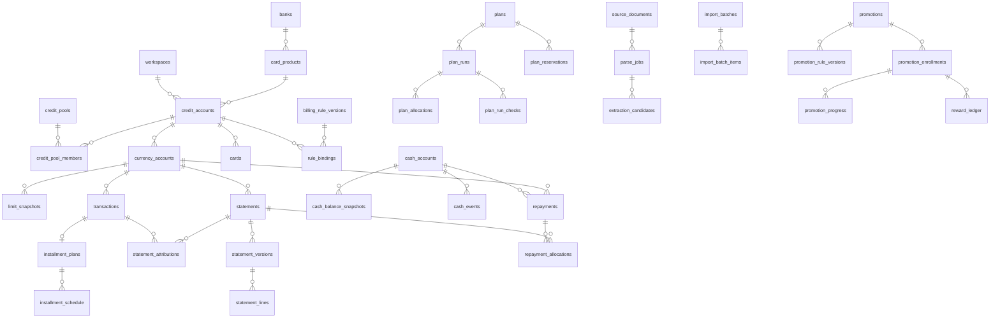

# 40 · 数据模型：ERD、数据字典、关键 DDL、约束、RLS、迁移与本地映射

版本 0.1 · 2026-10-16 · PostgreSQL 18。约定（ADR-008）：主键 UUIDv7；每表 `workspace_id`；金额 `*_minor BIGINT` + `currency CHAR(3)`；时间 `*_at TIMESTAMPTZ` + `*_tz TEXT` + `time_precision`；`confirmation_level`；追加更正不覆盖。

## 1. 实体组总览

| 组 | 表（T-前缀省略） | 说明 |
|---|---|---|
| 1 身份与空间 | users, workspaces, workspace_members, devices, auth_sessions, consents, idempotency_keys | 多用户隔离基础 |
| 2 银行与账户 | currencies, banks, card_products, credit_pools, credit_pool_members, credit_accounts, currency_accounts, cards, billing_rule_versions, rule_bindings | 卡片≠账户 |
| 3 额度 | limit_snapshots, limit_adjustments, preauth_holds, plan_reservations | 快照口径与占用 |
| 4 交易与账单 | transactions, transaction_links, statements, statement_versions, statement_lines, statement_attributions, installment_plans, installment_schedule, charges | 追加版本 |
| 5 现金与还款 | cash_accounts, cash_balance_snapshots, snapshot_included_events, cash_events, cash_transfers, recurring_items, repayments, repayment_allocations, reconciliation_items | 逐账户 |
| 6 规则与导入 | source_documents, parse_jobs, extraction_candidates, import_batches, import_batch_items, dedupe_keys | 溯源与幂等 |
| 7 计划与求解 | scenarios, forecast_runs, plans, plan_runs, plan_allocations, plan_run_checks, plan_invalidations | run_id 组织 |
| 8 活动 | promotion_sources, promotions, promotion_rule_versions, promotion_applicability, promotion_enrollments, promotion_progress, reward_ledger | 三层状态 |
| 9 权益/积分/年费 | benefit_definitions, benefit_grants, benefit_usages, points_accounts, points_batches, points_events, annual_fee_rules, annual_fee_cycles | |
| 10 通知/同步/审计 | notification_rules, notifications, sync_changes, sync_conflicts, audit_log, deletion_tasks, jobs | |

## 2. ERD（核心路径）



## 3. 数据字典（关键字段；完整字段以 DDL 为准）

| 表 | 关键字段 | 约束/说明 |
|---|---|---|
| workspaces | id, owner_user_id, kind(`real`/`demo`), created_at | demo 空间不可同步 |
| devices | id, workspace_id, public_key, name, platform, last_seen_at, revoked_at | 设备撤销即会话失效 |
| consents | id, workspace_id, purpose(`ai_extract`/`gmail`/`server_sync`/`analytics`…), granted_at, withdrawn_at, details | 隐私授权中心数据源 |
| idempotency_keys | workspace_id, key, request_hash, response_json, created_at | PK(workspace_id,key) |
| banks / card_products | name, country, business_tz_default; product: bank_id, name, network, benefits_template_id? | 产品模板来源标注 |
| credit_pools | id, workspace_id, bank_id, name, parent_pool_id | 多层池 |
| credit_accounts | id, workspace_id, bank_id, product_id, holder_alias, business_tz, status, opened_on, closed_on | 账单主体 |
| currency_accounts | id, workspace_id, credit_account_id, currency, is_primary | 账单/交易挂此 |
| cards | id, workspace_id, credit_account_id, last4, network, holder_kind(`primary`/`supplementary`), status, expires_ym, replaced_by_card_id, alias | 禁止存完整卡号（CHECK 长度=4） |
| billing_rule_versions | id, workspace_id?(null=官方模板), subject_kind/subject_id, statement_day, statement_day_inclusive, due_kind, due_day, due_month_offset, due_days, due_day_kind, holiday_rollover, cutoff_time, source, published_on, effective_from, effective_to, verified_on, version, review_status, exceptions | 同主体同时点唯一（排除约束） |
| limit_snapshots | id, workspace_id, currency_account_id, fixed_minor, temp_minor, temp_expires_on, special_minor, special_purpose, used_minor, available_raw_minor(可负), includes_holds, source_kind, source_document_id, balance_as_of, observed_at, recorded_at, confirmation_level | 不设非负约束 |
| plan_reservations | id, workspace_id, plan_id, currency_account_id, cash_account_id, amount_minor, status(`active`/`converted`/`released`), linked_transaction_id | 转换后不再占用 |
| transactions | id, workspace_id, currency_account_id, card_id?, txn_type, amount_minor(负债增加为正), currency, txn_at, txn_tz, time_precision, posted_on, merchant, mcc, category, status(`pending`/`posted`/`reversed`), bank_reference, parent_transaction_id, fingerprint, source_kind, source_document_id, confirmation_level, recorded_at | fingerprint 与 dedupe_keys 联动 |
| statements | id, workspace_id, currency_account_id, statement_date, due_date, status(§6.2), current_version_id | 账单主体 |
| statement_versions | id, workspace_id, statement_id, version_no, source_kind, source_document_id, previous_balance_minor, new_balance_minor, min_due_minor, payments_minor, credits_minor, fees_minor, interest_minor, installment_due_minor, credit_balance_minor, due_date, recorded_by, reason, recorded_at | 追加；金额列禁止 UPDATE（触发器） |
| installment_plans | id, workspace_id, transaction_id, principal_minor, periods, per_period_rate NUMERIC, fee_mode(`per_period`/`upfront`), remainder_policy(`last`/`first`), rounding(`HALF_UP`), status, early_settled_at | 成本 IRR 由投影计算 |
| installment_schedule | plan_id, period_no, principal_minor, interest_minor, statement_date, due_date, status | 未来分期本金来源 |
| cash_accounts | id, workspace_id, name, currency, kind(`bank`/`wallet`/`wealth`/`restricted`), usable_for_repayment, available_from, reserve_floor_minor | |
| cash_balance_snapshots | id, workspace_id, cash_account_id, balance_minor, balance_as_of(date), observed_at, source_kind, confirmation_level | 快照包含事件见 snapshot_included_events |
| cash_events | id, workspace_id, cash_account_id, event_on(date), event_at?, amount_minor, cls(`confirmed`/`expected`/`planned`), category, label, posting_status(`planned`/`posted`), recurring_item_id, linked_repayment_id, linked_plan_run_id | 唯一现金事实表 |
| repayments | id, workspace_id, currency_account_id, cash_account_id, amount_minor, currency, status(§6.3), method, payment_initiated_at, cash_debited_at, credit_posted_at, bank_confirmed_at, evidence_document_id, origin_device_id | 与 cash_events 关联 |
| repayment_allocations | repayment_id, statement_id, amount_minor | SUM ≤ repayment.amount（延迟约束触发器） |
| reconciliation_items | id, workspace_id, kind(`amount_mismatch`/`missing`/`duplicate_txn`/`duplicate_repayment`/`refund_pending`/`unmatched_repayment`/`sync_conflict`), refs JSONB, status, resolution, resolved_by, resolved_at | 待处理清单 |
| source_documents | id, workspace_id, sha256, mime, size_bytes, storage_key, dek_wrapped, uploaded_by_device_id, retention_until, deleted_at | 指纹唯一（workspace, sha256） |
| extraction_candidates | id, parse_job_id, field_path, raw_value, normalized_value, raw_location JSONB(page,bbox,line), parser_version, confidence NUMERIC, validations JSONB, confirmed_value, confirmed_by, confirmed_at | 字段溯源 |
| import_batches / import_batch_items | status(§6.4), kind, target_currency_account_id; item: candidate refs, decision(`new`/`duplicate`/`new_version`/`skip`), resulting_entity | 可回滚 |
| dedupe_keys | workspace_id, key_hash, entity_kind, entity_id | 唯一；由指纹+参考号+账户+类型+币种+入账时间构成 |
| plans | id, workspace_id, amount_minor, currency, txn_date, allow_split, max_cards, min_split_minor, payment_lead_days, channel, merchant, category, allow_installment, status | |
| plan_runs | id(run_id), workspace_id, plan_id, profile, decision_scenario_id, solver_status, business_status, input_hash, model_version, solver_version, protocol_version, time_limit_s, workers, seed, wall_time_s, result JSONB, created_at | 历史不覆盖 |
| plan_allocations | run_id, currency_account_id, card_id, amount_minor, statement_date, due_date, repay_on, repay_from_cash_account_id, buffer_days, fee_minor, verified_benefit_minor, potential_benefit_minor | |
| plan_run_checks | run_id, scenario_id, ok, ok_zero, min_balance_by_account JSONB, breaches JSONB, assumptions JSONB | |
| promotions / promotion_rule_versions | promotion: source_id, title, bank_id, status; version: rule JSONB(schema v1), source_url, source_document_id, published_on, effective_from/to, tz, verified_on, verified_by, status | 规则 JSON 经 schema 校验 |
| promotion_enrollments | workspace_id, promotion_id, credit_account_id/card_id, status(§6.6), eligibility(`eligible`/`ineligible`/`unknown`), unknown_reasons JSONB, user_confirmed_at, evidence_document_id | |
| reward_ledger | enrollment_id, period_key, estimated_minor, claimed_minor, posted_minor, posted_at, confirmation_level, clawback_minor, linked_transaction_id | 未到账不进确定现金 |
| benefit_grants / benefit_usages | grant: definition_id, credit_account_id, cycle_start, cycle_end, quota, remaining; usage: status(§6.7), reserved_at, used_at, cancelled_at, restored_at | |
| points_batches / points_events | batch: points_account_id, earned_at, expires_at, amount, source; event: kind(`earn`/`redeem`/`expire`/`reverse`), amount, batch_id | FIFO 扣减 |
| annual_fee_cycles | credit_account_id, period_start, period_end, fee_minor, waiver_rule JSONB, progress JSONB, status(§6.9), charged_at, refunded_at | |
| notifications | id, workspace_id, dedupe_key, kind, entity_ref, channel, scheduled_at, status, attempts, payload(不含金额) | UNIQUE(workspace_id, dedupe_key) |
| sync_changes | seq BIGSERIAL, workspace_id, table_name, row_id, op, row_version, payload JSONB, origin_device_id, created_at | 拉取游标 |
| sync_conflicts | id, workspace_id, table_name, row_id, server_version, client_base_version, server_payload, client_payload, status, resolved_by, resolved_at | |
| audit_log | id, workspace_id?, actor_kind, actor_id, action, target_table, target_id, before_hash, after_hash, ip, at | 不存正文 |
| deletion_tasks | workspace_id, requested_at, grace_until, status, executed_at | 与审计保留一致 |
| jobs | id, kind, payload JSONB, status, run_after, attempts, max_attempts, locked_by, locked_until, last_error, created_at | SKIP LOCKED |

## 4. 关键 DDL（节选，生产以 Alembic 迁移为准）

```sql
CREATE EXTENSION IF NOT EXISTS btree_gist;
CREATE EXTENSION IF NOT EXISTS pg_trgm;

CREATE TABLE currencies (
  code CHAR(3) PRIMARY KEY,
  minor_digits SMALLINT NOT NULL CHECK (minor_digits BETWEEN 0 AND 3)
);

CREATE TABLE workspaces (
  id UUID PRIMARY KEY,
  owner_user_id UUID NOT NULL REFERENCES users(id),
  kind TEXT NOT NULL CHECK (kind IN ('real','demo')),
  created_at TIMESTAMPTZ NOT NULL DEFAULT now(),
  deleted_at TIMESTAMPTZ
);

CREATE TABLE credit_accounts (
  id UUID PRIMARY KEY,
  workspace_id UUID NOT NULL REFERENCES workspaces(id),
  bank_id UUID NOT NULL REFERENCES banks(id),
  product_id UUID REFERENCES card_products(id),
  holder_alias TEXT NOT NULL,
  business_tz TEXT NOT NULL DEFAULT 'Asia/Shanghai',
  status TEXT NOT NULL CHECK (status IN ('active','frozen','closed')),
  row_version BIGINT NOT NULL DEFAULT 1,
  updated_at TIMESTAMPTZ NOT NULL DEFAULT now(),
  deleted_at TIMESTAMPTZ,
  UNIQUE (workspace_id, id)
);

CREATE TABLE currency_accounts (
  id UUID PRIMARY KEY,
  workspace_id UUID NOT NULL,
  credit_account_id UUID NOT NULL,
  currency CHAR(3) NOT NULL REFERENCES currencies(code),
  is_primary BOOLEAN NOT NULL DEFAULT false,
  row_version BIGINT NOT NULL DEFAULT 1,
  UNIQUE (workspace_id, id),
  UNIQUE (credit_account_id, currency),
  FOREIGN KEY (workspace_id, credit_account_id) REFERENCES credit_accounts(workspace_id, id)
);

CREATE TABLE cards (
  id UUID PRIMARY KEY,
  workspace_id UUID NOT NULL,
  credit_account_id UUID NOT NULL,
  last4 CHAR(4) NOT NULL CHECK (last4 ~ '^[0-9]{4}$'),
  network TEXT,
  holder_kind TEXT NOT NULL CHECK (holder_kind IN ('primary','supplementary')),
  status TEXT NOT NULL CHECK (status IN ('draft','active','frozen','replaced','closed')),
  expires_ym CHAR(7),
  replaced_by_card_id UUID,
  alias TEXT,
  row_version BIGINT NOT NULL DEFAULT 1,
  UNIQUE (workspace_id, id),
  FOREIGN KEY (workspace_id, credit_account_id) REFERENCES credit_accounts(workspace_id, id),
  FOREIGN KEY (workspace_id, replaced_by_card_id) REFERENCES cards(workspace_id, id)
);

CREATE TABLE billing_rule_versions (
  id UUID PRIMARY KEY,
  workspace_id UUID,                       -- NULL = 官方模板（后台维护）
  subject_kind TEXT NOT NULL CHECK (subject_kind IN ('product','credit_account','currency_account')),
  subject_id UUID NOT NULL,
  statement_day SMALLINT NOT NULL CHECK (statement_day BETWEEN 1 AND 31),
  statement_day_inclusive BOOLEAN NOT NULL DEFAULT true,
  due_kind TEXT NOT NULL CHECK (due_kind IN ('fixed_day','days_after_statement')),
  due_day SMALLINT CHECK (due_day BETWEEN 1 AND 31),
  due_month_offset SMALLINT NOT NULL DEFAULT 0 CHECK (due_month_offset IN (0,1,2)),
  due_days SMALLINT CHECK (due_days BETWEEN 1 AND 60),
  due_day_kind TEXT NOT NULL DEFAULT 'calendar' CHECK (due_day_kind IN ('calendar','business')),
  holiday_rollover TEXT NOT NULL DEFAULT 'none' CHECK (holiday_rollover IN ('none','next_business_day')),
  source TEXT NOT NULL,
  published_on DATE,
  effective_from DATE NOT NULL,
  effective_to DATE,
  verified_on DATE,
  version INT NOT NULL,
  review_status TEXT NOT NULL CHECK (review_status IN ('draft','in_review','verified','published','user_declared','expired')),
  exceptions TEXT,
  CHECK ((due_kind='fixed_day' AND due_day IS NOT NULL) OR (due_kind='days_after_statement' AND due_days IS NOT NULL)),
  EXCLUDE USING gist (subject_id WITH =, daterange(effective_from, effective_to, '[)') WITH &&)
    WHERE (review_status IN ('published','user_declared'))
);

CREATE TABLE limit_snapshots (
  id UUID PRIMARY KEY,
  workspace_id UUID NOT NULL,
  currency_account_id UUID NOT NULL,
  fixed_minor BIGINT NOT NULL,
  temp_minor BIGINT NOT NULL DEFAULT 0,
  temp_expires_on DATE,
  special_minor BIGINT NOT NULL DEFAULT 0,
  special_purpose TEXT,
  used_minor BIGINT NOT NULL,
  available_raw_minor BIGINT NOT NULL,          -- 可为负：超限原值保留
  includes_holds BOOLEAN NOT NULL,
  source_kind TEXT NOT NULL CHECK (source_kind IN ('bank_app','statement','user','import')),
  source_document_id UUID,
  balance_as_of TIMESTAMPTZ NOT NULL,
  observed_at TIMESTAMPTZ NOT NULL,
  recorded_at TIMESTAMPTZ NOT NULL DEFAULT now(),
  confirmation_level TEXT NOT NULL CHECK (confirmation_level IN ('system_estimated','user_confirmed','bank_confirmed')),
  UNIQUE (workspace_id, id),
  FOREIGN KEY (workspace_id, currency_account_id) REFERENCES currency_accounts(workspace_id, id)
);
CREATE INDEX ON limit_snapshots (currency_account_id, balance_as_of DESC);

CREATE TABLE transactions (
  id UUID PRIMARY KEY,
  workspace_id UUID NOT NULL,
  currency_account_id UUID NOT NULL,
  card_id UUID,
  txn_type TEXT NOT NULL CHECK (txn_type IN ('purchase','refund','reversal','cash_advance','fee','interest','repayment','transfer','preauth','installment_principal','adjustment')),
  amount_minor BIGINT NOT NULL,                 -- 负债增加为正，贷记为负
  currency CHAR(3) NOT NULL REFERENCES currencies(code),
  txn_at TIMESTAMPTZ NOT NULL,
  txn_tz TEXT NOT NULL,
  time_precision TEXT NOT NULL CHECK (time_precision IN ('datetime','date','month')),
  posted_on DATE,
  merchant TEXT, mcc CHAR(4), category TEXT,
  status TEXT NOT NULL CHECK (status IN ('pending','posted','reversed')),
  bank_reference TEXT,
  parent_transaction_id UUID,
  fingerprint TEXT NOT NULL,
  source_kind TEXT NOT NULL,
  source_document_id UUID,
  confirmation_level TEXT NOT NULL,
  recorded_at TIMESTAMPTZ NOT NULL DEFAULT now(),
  row_version BIGINT NOT NULL DEFAULT 1,
  deleted_at TIMESTAMPTZ,
  UNIQUE (workspace_id, id),
  FOREIGN KEY (workspace_id, currency_account_id) REFERENCES currency_accounts(workspace_id, id),
  FOREIGN KEY (workspace_id, card_id) REFERENCES cards(workspace_id, id),
  FOREIGN KEY (workspace_id, parent_transaction_id) REFERENCES transactions(workspace_id, id)
);
CREATE INDEX ON transactions (currency_account_id, posted_on);
CREATE INDEX ON transactions (workspace_id, fingerprint);
CREATE INDEX ON transactions USING gin (merchant gin_trgm_ops);

CREATE TABLE statements (
  id UUID PRIMARY KEY,
  workspace_id UUID NOT NULL,
  currency_account_id UUID NOT NULL,
  statement_date DATE NOT NULL,
  due_date DATE NOT NULL CHECK (due_date > statement_date),
  status TEXT NOT NULL CHECK (status IN ('predicted','issued','amended','partially_settled','settled','overdue')),
  current_version_id UUID,
  row_version BIGINT NOT NULL DEFAULT 1,
  UNIQUE (workspace_id, id),
  UNIQUE (currency_account_id, statement_date),
  FOREIGN KEY (workspace_id, currency_account_id) REFERENCES currency_accounts(workspace_id, id)
);

CREATE TABLE statement_versions (
  id UUID PRIMARY KEY,
  workspace_id UUID NOT NULL,
  statement_id UUID NOT NULL,
  version_no INT NOT NULL,
  source_kind TEXT NOT NULL CHECK (source_kind IN ('pdf','email','screenshot','csv','manual','correction')),
  source_document_id UUID,
  previous_balance_minor BIGINT, new_balance_minor BIGINT NOT NULL, min_due_minor BIGINT,
  payments_minor BIGINT, credits_minor BIGINT, fees_minor BIGINT, interest_minor BIGINT,
  installment_due_minor BIGINT, credit_balance_minor BIGINT,   -- 溢缴款/贷方余额
  due_date DATE NOT NULL,
  recorded_by TEXT NOT NULL, reason TEXT,
  recorded_at TIMESTAMPTZ NOT NULL DEFAULT now(),
  UNIQUE (statement_id, version_no),
  UNIQUE (workspace_id, id),
  FOREIGN KEY (workspace_id, statement_id) REFERENCES statements(workspace_id, id)
);
-- 银行原值不可覆盖：金额列只允许 INSERT
CREATE OR REPLACE FUNCTION forbid_amount_update() RETURNS trigger AS $$
BEGIN
  RAISE EXCEPTION 'statement_versions amounts are append-only; insert a new version';
END $$ LANGUAGE plpgsql;
CREATE TRIGGER statement_versions_append_only
  BEFORE UPDATE OF previous_balance_minor, new_balance_minor, min_due_minor, payments_minor,
                   credits_minor, fees_minor, interest_minor, installment_due_minor, credit_balance_minor, due_date
  ON statement_versions FOR EACH ROW EXECUTE FUNCTION forbid_amount_update();

CREATE TABLE cash_accounts (
  id UUID PRIMARY KEY,
  workspace_id UUID NOT NULL REFERENCES workspaces(id),
  name TEXT NOT NULL,
  currency CHAR(3) NOT NULL REFERENCES currencies(code),
  kind TEXT NOT NULL CHECK (kind IN ('bank','wallet','wealth','restricted')),
  usable_for_repayment BOOLEAN NOT NULL DEFAULT true,
  available_from DATE,
  reserve_floor_minor BIGINT NOT NULL DEFAULT 0 CHECK (reserve_floor_minor >= 0),
  row_version BIGINT NOT NULL DEFAULT 1,
  UNIQUE (workspace_id, id)
);

CREATE TABLE cash_balance_snapshots (
  id UUID PRIMARY KEY,
  workspace_id UUID NOT NULL,
  cash_account_id UUID NOT NULL,
  balance_minor BIGINT NOT NULL,
  balance_as_of DATE NOT NULL,
  observed_at TIMESTAMPTZ NOT NULL,
  source_kind TEXT NOT NULL,
  confirmation_level TEXT NOT NULL,
  UNIQUE (workspace_id, id),
  FOREIGN KEY (workspace_id, cash_account_id) REFERENCES cash_accounts(workspace_id, id)
);
CREATE TABLE snapshot_included_events (
  snapshot_id UUID NOT NULL REFERENCES cash_balance_snapshots(id) ON DELETE CASCADE,
  cash_event_id UUID NOT NULL,
  PRIMARY KEY (snapshot_id, cash_event_id)
);

CREATE TABLE cash_events (
  id UUID PRIMARY KEY,
  workspace_id UUID NOT NULL,
  cash_account_id UUID NOT NULL,
  event_on DATE NOT NULL,
  event_at TIMESTAMPTZ,
  amount_minor BIGINT NOT NULL,
  cls TEXT NOT NULL CHECK (cls IN ('confirmed','expected','planned')),
  category TEXT NOT NULL CHECK (category IN ('income','bill','living','repayment','transfer_in','transfer_out','fee','other')),
  label TEXT,
  posting_status TEXT NOT NULL CHECK (posting_status IN ('planned','posted')),
  recurring_item_id UUID,
  linked_repayment_id UUID,
  linked_plan_run_id UUID,
  row_version BIGINT NOT NULL DEFAULT 1,
  deleted_at TIMESTAMPTZ,
  UNIQUE (workspace_id, id),
  FOREIGN KEY (workspace_id, cash_account_id) REFERENCES cash_accounts(workspace_id, id)
);
CREATE INDEX ON cash_events (cash_account_id, event_on) WHERE deleted_at IS NULL;

CREATE TABLE repayments (
  id UUID PRIMARY KEY,
  workspace_id UUID NOT NULL,
  currency_account_id UUID NOT NULL,
  cash_account_id UUID,
  amount_minor BIGINT NOT NULL CHECK (amount_minor > 0),
  currency CHAR(3) NOT NULL,
  status TEXT NOT NULL CHECK (status IN ('recorded','processing','cash_debited','credit_posted','bank_confirmed','failed','user_marked_paid','needs_review','reversed')),
  method TEXT,
  payment_initiated_at TIMESTAMPTZ, cash_debited_at TIMESTAMPTZ, credit_posted_at TIMESTAMPTZ, bank_confirmed_at TIMESTAMPTZ,
  evidence_document_id UUID,
  origin_device_id UUID,
  row_version BIGINT NOT NULL DEFAULT 1,
  deleted_at TIMESTAMPTZ,
  UNIQUE (workspace_id, id),
  FOREIGN KEY (workspace_id, currency_account_id) REFERENCES currency_accounts(workspace_id, id),
  FOREIGN KEY (workspace_id, cash_account_id) REFERENCES cash_accounts(workspace_id, id),
  CHECK (status <> 'bank_confirmed' OR bank_confirmed_at IS NOT NULL)
);

CREATE TABLE repayment_allocations (
  repayment_id UUID NOT NULL,
  statement_id UUID NOT NULL,
  workspace_id UUID NOT NULL,
  amount_minor BIGINT NOT NULL CHECK (amount_minor > 0),
  PRIMARY KEY (repayment_id, statement_id),
  FOREIGN KEY (workspace_id, repayment_id) REFERENCES repayments(workspace_id, id),
  FOREIGN KEY (workspace_id, statement_id) REFERENCES statements(workspace_id, id)
);
-- 分配和不得超过还款额：CONSTRAINT TRIGGER … DEFERRABLE INITIALLY DEFERRED（迁移中实现）

CREATE TABLE plan_runs (
  id UUID PRIMARY KEY,                       -- run_id
  workspace_id UUID NOT NULL,
  plan_id UUID NOT NULL,
  profile TEXT NOT NULL CHECK (profile IN ('cash_safety','verified_benefit','fewer_cards')),
  decision_scenario_id UUID NOT NULL,
  solver_status TEXT NOT NULL CHECK (solver_status IN ('OPTIMAL','FEASIBLE','INFEASIBLE','UNKNOWN','MODEL_INVALID','NOT_RUN')),
  business_status TEXT NOT NULL CHECK (business_status IN ('NEEDS_DATA','MODEL_INVALID','BASELINE_SHORTFALL','INFEASIBLE','UNKNOWN','FEASIBLE_ROBUST','CONDITIONALLY_FEASIBLE')),
  input_hash TEXT NOT NULL, model_version TEXT NOT NULL, solver_version TEXT NOT NULL, protocol_version TEXT NOT NULL,
  time_limit_s NUMERIC(8,3) NOT NULL, workers SMALLINT NOT NULL, seed INT NOT NULL, wall_time_s NUMERIC(10,3),
  computed_locally BOOLEAN NOT NULL DEFAULT false,
  result JSONB NOT NULL,
  created_at TIMESTAMPTZ NOT NULL DEFAULT now(),
  UNIQUE (workspace_id, id),
  FOREIGN KEY (workspace_id, plan_id) REFERENCES plans(workspace_id, id)
);
CREATE TABLE plan_allocations (
  run_id UUID NOT NULL REFERENCES plan_runs(id),
  currency_account_id UUID NOT NULL,
  card_id UUID,
  amount_minor BIGINT NOT NULL CHECK (amount_minor > 0),
  statement_date DATE NOT NULL, due_date DATE NOT NULL, repay_on DATE NOT NULL,
  repay_from_cash_account_id UUID NOT NULL,
  buffer_days INT NOT NULL,
  fee_minor BIGINT NOT NULL DEFAULT 0, verified_benefit_minor BIGINT NOT NULL DEFAULT 0, potential_benefit_minor BIGINT NOT NULL DEFAULT 0,
  PRIMARY KEY (run_id, currency_account_id)
);

CREATE TABLE source_documents (
  id UUID PRIMARY KEY,
  workspace_id UUID NOT NULL REFERENCES workspaces(id),
  sha256 CHAR(64) NOT NULL,
  mime TEXT NOT NULL, size_bytes BIGINT NOT NULL CHECK (size_bytes <= 26214400),
  storage_key TEXT NOT NULL, dek_wrapped BYTEA NOT NULL,
  uploaded_by_device_id UUID, retention_until DATE, deleted_at TIMESTAMPTZ,
  created_at TIMESTAMPTZ NOT NULL DEFAULT now(),
  UNIQUE (workspace_id, sha256)
);

CREATE TABLE dedupe_keys (
  workspace_id UUID NOT NULL,
  key_hash CHAR(64) NOT NULL,
  entity_kind TEXT NOT NULL, entity_id UUID NOT NULL,
  PRIMARY KEY (workspace_id, key_hash)
);

CREATE TABLE idempotency_keys (
  workspace_id UUID NOT NULL,
  key TEXT NOT NULL,
  request_hash CHAR(64) NOT NULL,
  response_status SMALLINT NOT NULL, response_body JSONB NOT NULL,
  created_at TIMESTAMPTZ NOT NULL DEFAULT now(),
  PRIMARY KEY (workspace_id, key)
);

CREATE TABLE sync_changes (
  seq BIGSERIAL PRIMARY KEY,
  workspace_id UUID NOT NULL,
  table_name TEXT NOT NULL, row_id UUID NOT NULL,
  op TEXT NOT NULL CHECK (op IN ('insert','update','delete')),
  row_version BIGINT NOT NULL, payload JSONB,
  origin_device_id UUID, created_at TIMESTAMPTZ NOT NULL DEFAULT now()
);
CREATE INDEX ON sync_changes (workspace_id, seq);

CREATE TABLE audit_log (
  id UUID PRIMARY KEY,
  workspace_id UUID,
  actor_kind TEXT NOT NULL, actor_id UUID, action TEXT NOT NULL,
  target_table TEXT, target_id UUID,
  before_hash CHAR(64), after_hash CHAR(64), ip INET,
  at TIMESTAMPTZ NOT NULL DEFAULT now()
);

CREATE TABLE jobs (
  id UUID PRIMARY KEY,
  kind TEXT NOT NULL, payload JSONB NOT NULL,
  status TEXT NOT NULL CHECK (status IN ('queued','running','succeeded','failed','dead')),
  run_after TIMESTAMPTZ NOT NULL DEFAULT now(),
  attempts INT NOT NULL DEFAULT 0, max_attempts INT NOT NULL DEFAULT 5,
  locked_by TEXT, locked_until TIMESTAMPTZ, last_error TEXT,
  created_at TIMESTAMPTZ NOT NULL DEFAULT now()
);
CREATE INDEX ON jobs (status, run_after) WHERE status = 'queued';
```

活动、权益、积分、年费、通知、冲突、删除任务表按 §3 字典同样模式建表（每表 `workspace_id` + `UNIQUE(workspace_id,id)` + 复合外键）。

## 5. 索引策略

- 时间范围查询：`(currency_account_id, posted_on)`、`(cash_account_id, event_on)`、`(statement_id, version_no)`。
- 去重：`(workspace_id, fingerprint)`、`dedupe_keys` 主键、`source_documents (workspace_id, sha256)`。
- 同步：`sync_changes (workspace_id, seq)`；`idempotency_keys` 主键。
- 任务：部分索引 `jobs (status, run_after) WHERE status='queued'`。
- 搜索：`pg_trgm` GIN 于 `transactions.merchant`、`cash_events.label`、`promotions.title`。

## 6. 所有权与 RLS（R-DATA-05）

```sql
-- 应用连接角色无 BYPASSRLS；每个请求 SET LOCAL app.workspace_id
ALTER TABLE transactions ENABLE ROW LEVEL SECURITY;
ALTER TABLE transactions FORCE ROW LEVEL SECURITY;
-- 连接上一次事务设置过该参数后，未设置时读到的是 '' 而不是 NULL（M0 T-002 实测），必须 NULLIF，否则 ''::uuid 报错
CREATE POLICY ws_isolation ON transactions
  USING (workspace_id = NULLIF(current_setting('app.workspace_id', true), '')::uuid)
  WITH CHECK (workspace_id = NULLIF(current_setting('app.workspace_id', true), '')::uuid);
-- 同样策略应用于所有带 workspace_id 的表；官方模板表（workspace_id IS NULL）单独策略允许只读
CREATE ROLE cardflow_app NOLOGIN;            -- 业务角色
CREATE ROLE cardflow_admin NOLOGIN;          -- 后台角色：只通过元数据视图访问；不授予 statement_versions/transactions/source_documents 正文列
```

- 所有跨表关联使用复合外键 `(workspace_id, id)`，数据库层杜绝跨工作空间串联。
- 绕过测试（TC-DB-05）：用 app 角色设置错误 workspace_id 读取/写入/关联他人数据必须失败；用 admin 角色读取账单正文列必须失败；运营视图只暴露计数与状态。
- 幂等键唯一约束与业务写入同事务提交。

## 7. 迁移策略

- Alembic 线性迁移，expand/contract 两阶段（先加列/表与双写，后删旧）；每个迁移附回滚；CI 对空库与"上一版本快照库"各跑一次升级 + 回滚 + 再升级。
- 迁移禁止 `UPDATE` 金额原值；数据修正以新版本/冲销行实现，并写审计。
- `/readyz` 校验 Alembic 版本与代码期望一致。

## 8. 移动端本地映射（drift）

| 服务端表 | 本地表 | 差异 |
|---|---|---|
| 所有可同步表 | 同名 | 额外列：`local_seq`、`sync_state`(`clean`/`dirty`/`conflict`)、`server_row_version` |
| sync_changes | 无（改为 `sync_cursor` 单行表） | 仅存拉取游标 |
| sync_outbox | 本地独有 | op/table/row_id/payload/base_version/idempotency_key/local_seq |
| source_documents | 本地存文件密钥与路径 | 文件在应用私有目录 AES-GCM |
| plan_runs | 同名 + `computed_locally` | 本地有限搜索结果标注 |
| jobs/audit_log/admin 表 | 不同步 | 服务端独有 |

本地数据库加密密钥：`flutter_secure_storage`（iOS Keychain `kSecAttrAccessibleWhenUnlockedThisDeviceOnly`，Android Keystore）；备份不包含该密钥，备份自有口令派生密钥。

## 9. 数据保留与删除

| 数据 | 默认保留 | 删除方式 |
|---|---|---|
| 原始附件 | 用户设置（默认 24 个月） | 立即逻辑删除 + 7 天后物理删除；密钥销毁 |
| 财务事实 | 工作空间存续期 | 工作空间删除任务：30 天宽限后物理删除；审计只留哈希 |
| tombstone | ≥90 天 | 压缩任务 |
| 审计 | 365 天（可配） | 定期归档 |

## 10. M0 审查后的结构修订（迁移 0002，2026-10-17）

依据 `evidence/m0/review-wave2-schema.md`（R2-01~R2-36），由主会话裁决。以下规则对后续所有迁移同样适用。

1. 触发器与检查函数一律 `SET search_path = pg_catalog, public, pg_temp`，函数体内表名用 `public.` 全限定，防止会话临时表遮蔽（R2-01）。
2. 金额聚合约束必须在任何隔离级别下成立：用"写冲突"实现（例如还款分配合计行），不依赖 READ COMMITTED（R2-02）。
3. 银行事实与运行记录不可改：
   - statement_versions、statement_lines、plan_runs、plan_allocations、plan_run_checks 整行不可 UPDATE。唯一例外：deleted_at 由 NULL 置为非 NULL 一次（tombstone，导入回滚用，同时写审计）。
   - limit_snapshots、cash_balance_snapshots 的金额列与时间列不可改。
   - 明细行只能与所属版本在同一事务内写入。
   - 物理删除只允许在带事务级清除令牌的事务里进行（`app.purge` 必须等于当前事务号）；应用角色不授予 DELETE（R2-03、R2-10、R2-19）。
4. 币种一致：凡同时带账户与 currency 的表，用 `(workspace_id, 账户, currency)` 复合外键指向账户上的 `UNIQUE (workspace_id, id, currency)`。账户的币种与所属信用账户不可修改（R2-04）。
5. 同账户一致：用携带账户列的复合外键表达这类关系，包括"卡属于该信用账户""交易与账单属于同一币种子账户""快照包含的事件属于同一现金账户"等。冗余的账户列由 BEFORE 触发器从父行推导，客户端不需要提供（R2-05）。
6. tombstone 与自然键：
   - 主键一律为 id。
   - 自然键唯一改为 `WHERE deleted_at IS NULL` 的部分唯一索引，涉及账单日、子账户币种、池成员、附件指纹、分配、归属、快照包含等。
   - `(statement_id, version_no)` 保持全量唯一，版本号永不复用（R2-06）。
7. 同步：
   - `sync_changes` 增加 `txid xid8 NOT NULL DEFAULT pg_current_xact_id()`。拉取规则见 architecture §6（R2-07）。
   - 可同步表的 row_version 与 updated_at 由通用 BEFORE UPDATE 触发器维护（R2-21）。
8. 时间（ADR-008）：repayments 增加时区、关键时间的精度列与 recorded_at；transactions 增加 observed_at；cash_events 增加 event_tz 与 recorded_at（R2-08）。
9. 卡号兜底：
   - 自由文本列加 `CHECK (NOT looks_like_pan(col))`：13–19 位数字、可含空格或短横、且 Luhn 校验通过，即视为卡号。
   - 应用层仍按 R-CARD-02 拒绝用户输入中任何 ≥13 位的连续数字。
   - 解析器落库前做掩码（R2-09）。
10. 其他修订：
    - 所有租户表的 workspace_id 不可改（R2-11）。
    - 工作空间 id 不得为全零 UUID（R2-12）。
    - 工作空间私有规则不得标 verified/published（R2-13）。
    - rule_bindings 生效期不重叠（R2-14）。
    - 已删除、已冲正或失败的还款，有效分配合计必须为 0（R2-15）。
    - 金额非零，并按交易类型或现金类别约束符号；约定写入 COMMENT ON COLUMN（R2-16、R2-32）。
    - 有状态机的状态列加 CHECK（R2-17）。
    - 授信池与换卡链禁止成环（R2-18）。
    - 附件引用改为复合外键；附件清除时擦除 blob 与包裹密钥，保留元数据行（R2-20）。
    - 外键列补索引（R2-25）。
    - jobs 增加租约回收用的部分索引与 dedupe_key（R2-27）。
11. 暂缓项（记录在案）：
    - 规则主体改为显式外键列，并支持"银行"级主体（R2-11 后半、R2-22）：M1 WP-10/11。
    - 时区名在应用层校验（R2-28）：M1。
    - 同步载荷的列白名单（R2-35）：M4 WP-40。
    - trgm 索引按工作空间划分（R2-36）：规模增长时再做。
    - 组 8、组 9 与通知表：在 M3/M4 的迁移中按同样约定建立（R2-22）。
12. 状态值集（R2-17，M0 拟定，规格此前未定义）：
    - installment_plans：active / completed / early_settled / cancelled
    - installment_schedule：scheduled / billed / settled / cancelled
    - preauth_holds：active / captured / released / expired
    - parse_jobs：queued / running / succeeded / failed / quarantined
    - reconciliation_items：open / resolved / dismissed
    - sync_conflicts：open / resolved
    - deletion_tasks：pending / cancelled / executing / executed / failed
    - jobs：queued / running / succeeded / failed / dead / cancelled
    
    拼写统一为英式 `cancelled`（与 PRD 一致）；jobs 原用的 `canceled` 在迁移 0003 中更正，admin-console-spec AP-05 同步更正。
13. 角色与 RLS 已由迁移 0003 实现，设计、授权矩阵与威胁模型见 `evidence/m0/T-006/rls-design.md`，摘要见 security-privacy §4.1。后续补充（2026-10-17 主会话裁决）：
    - limit_snapshots、cash_balance_snapshots 的 deleted_at 与五张不可变事实表一致，只能由 NULL 置为非 NULL 一次，不得撤销 tombstone。随迁移 0004 实施。
    - 后台写操作的授权（审计写入、任务重试/取消、设备撤销、用户禁用）随 T-031 的迁移实施。
